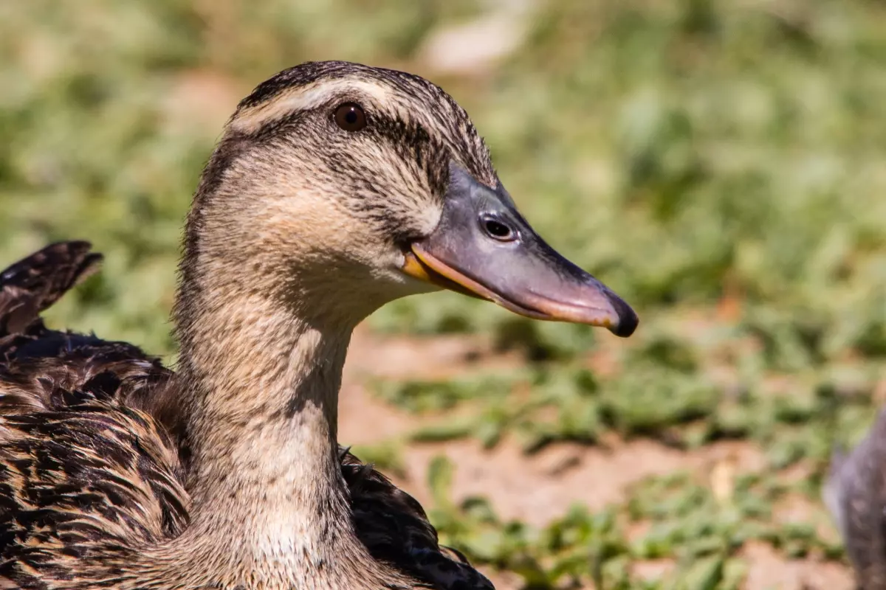

Source: [U.S. Fish & Wildlife Service](https://www.fws.gov/story/ducks-your-pool)

**Contents**

- [Duck biology](#duck-biology)
    - [Migration](#migration)
    - [Territory/Breeding](#territorybreeding)
- [Ducks in enclosed areas or in a pool](#ducks-in-enclosed-areas-or-in-a-pool)
    - [What to do if you have nesting ducks in your yard](#what-to-do-if-you-have-nesting-ducks-in-your-yard)
    - [What to do to discourage nesting and swimming in pools](#what-to-do-to-discourage-nesting-and-swimming-in-pools)
    - [What to do if you find a nest](#what-to-do-if-you-find-a-nest)
    - [What to do if you find ducks in your pool](#what-to-do-if-you-find-ducks-in-your-pool)
    - [Getting ducks out of the enclosed area (yard)](#getting-ducks-out-of-the-enclosed-area-yard)
- [Nests with eggs and chicks are protected](#nests-with-eggs-and-chicks-are-protected)
- [Legal Status](#legal-status)

# Duck biology

## Migration

Mallards (Anas platyrhynchos) often migrate unless there is sufficient food and water available throughout the year. Many migrating individuals spend their winters in the Gulf Coast and fly to the Northern U.S. and Canada in the spring. For migrating Mallards, spring migration begins in March. In many western states, Mallards are present year round.

## Territory/Breeding

Mallards begin to defend a territory about 200 yards from where the nesting takes place. They often defend the territory to isolate the female from other males from April-mid May. Mallards build their nests between April-May and breed through the beginning of August. These birds can be secretive during the breeding seasons and may nest in places that are not easily accessible.

In the early evening for a week or more, a Mallard pair will be searching for a place to build a nest. The female is more persistent in the search and will quack often, accompanied by alertness. The nest may be located under shrubs, bushes, in an open field, garden, tall grass, or on muskrat homes. It starts out as a few scrapes in the ground, and once eggs are laid, leaves, grass, reeds, and down feathers from the females’ breast are added for protection. Nests can be located 100 feet or less from open water and can be found in woods, fields, or cattails.

# Ducks in enclosed areas or in a pool

Your yard may be providing ducks with the ideal place to build a nest. You may have vegetation and water that provides them with resources to live and build a nest in hopes they will succeed in raising a brood.

Here, we provide you with some suggestions when ducks have decided to make your yard, or other enclosed area, a temporary home.

## What to do if you have nesting ducks in your yard:

- Enjoy the wildlife
- Observe their behavior

## What to do to discourage nesting and swimming in pools

- When you see a pair of ducks, or a female quacking often, they may be searching for a nest site. If you do not want the ducks to nest in your yard, chase the ducks away when you see them spending their early evenings in your yard.
- If you have a dog, allow it to patrol your yard before the ducks build a nest to help scare the birds off.
- If you find an inactive nest (no eggs), you may destroy the nest.  You may need to do this often because the ducks may attempt to rebuild. You may not destroy a nest with eggs in it.
- Place brightly-colored inflatable pool toys in the pool. Ducks will be discouraged by the objects.
- Cover your pool when it is not in use.
- Keep low-lying shrubs and cut grass to discourage them from building a nest.
- Do not leave food out and do not feed the ducks.

## What to do if you find a nest:

- Observe the nesting and development process of ducks.
- Only if you do not want Mallards to nest in your yard, destroy the nest before it contains eggs. You may not destroy an active nest with eggs.

## What to do if you find ducks in your pool

- Provide a ramp to allow ducklings to get out. You may use any surface that’s not too slippery for the ducklings’ feet, to help them walkout of the pool. Ducklings are not able to fly out of the water, nor can they step out from the pools tall ledge. The ducklings may drown if they become exhausted because they cannot get out.

## Getting ducks out of the enclosed area (yard)

- Leave a gate open to make it easy for ducks to exit the enclosed area. You may quietly escort ducks out of the enclosed area. Be careful not to scare the mother away from her chicks. If you are unable to remove the ducks from the area, call a licensed wildlife rehabilitator to physically remove the ducks.

# Nests with eggs and chicks are protected

You may not destroy nests with eggs or chicks inside. After about 25 days of incubation, the chicks will hatch. Within 24 hours, the mother will lead her chicks to water. Keep children and pets away from the duck family.

# Legal Status

Mallards are protected under the Migratory Bird Treaty Act of 1918. It is illegal for any person to take, possess, transport, sell, or purchase them or their parts, such as feathers, nests, or eggs, without a permit. Active nests with eggs or chicks may not be touched or destroyed without a permit from the U.S. Fish and Wildlife Service. Inactive (empty) nests do not require a permit to destroy. The U.S. Fish and Wildlife Service does not issue permits to remove Mallards, eggs, nor nests that are occupying a pool or an enclosed yard.