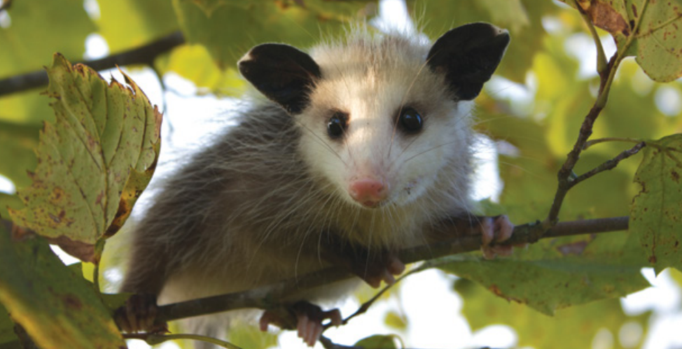

Welcome to the Pasadena Humane Wildlife Helpline Wiki! It acts as a central hub for training, guides, and "how to" procedures.

The Wiki is hosted on GitHub. If you are new to it, here are some tips on [navigating GitHub](Navigating-GitHub).

**Contents**

- [Guides](#guides)
- [How To](#how-to)
- [Flyers](#flyers)
- [Issues](#issues)

# Guides

- [Referrals](Referrals)
- [Template Responses](Template-Responses)
- [Training Guides](Training-Guides)
- [Wildlife Conflict Guide (WCG)](Wildlife-Conflict-Guide)

# How To

:hospital: [How to Admit a Patient](WRMD-How-to-Admit-a-Patient) 

:world_map: [How to Check Service Area](How-to-Check-Service-Area)

:clipboard: [How to Fill Out the Helpline Log](How-to-Fill-Out-the-Helpline-Log)

:package: [How to Intake Dropped Off Animals](How-to-Intake-Dropped-Off-Animals)

:printer: [How to Print Cage Cards](WRMD-How-to-Print-Cage-Cards)

:minibus: [How to Request ACO Dispatch](Teams-ACO-Dispatch)

:construction: [How to Request Humane Exclusion](Teams-Humane-Exclusion)

# Flyers

:bear: [Bear-English](https://pasadenahumane.org/wp-content/uploads/2023/04/23_4_Wildlife-Flyers_Web_Bear.pdf), [Bear-Spanish](https://pasadenahumane.org/wp-content/uploads/2025/08/24_11_WildlifeFlyers_Bear_SPA.pdf), [Bear-Armenian](https://pasadenahumane.org/wp-content/uploads/2025/08/24_12_6_WildlifeFlyers_Bear_ARM.pdf), [Bear-Traditional Chinese](https://pasadenahumane.org/wp-content/uploads/2025/08/24_11_WildlifeFlyers_Bear_TCH.pdf)

:cat: [Bobcat-English](https://pasadenahumane.org/wp-content/uploads/2023/04/23_4_Wildlife-Flyers_Web_Bobcat.pdf), [Bobcat-Spanish](https://pasadenahumane.org/wp-content/uploads/2025/08/24_11_WildlifeFlyers_Bobcat_SP.pdf), [Bobcat-Armenian](https://pasadenahumane.org/wp-content/uploads/2025/08/24_11_WildlifeFlyers_Bobcat_ARM.pdf), [Bobcat-Traditional Chinese](https://pasadenahumane.org/wp-content/uploads/2025/08/24_11_WildlifeFlyers_Bobcat_TCH.pdf)

:wolf: [Coyote-English](https://pasadenahumane.org/wp-content/uploads/2023/04/23_4_Wildlife-Flyers_Web_Coyote.pdf), [Coyote-Spanish](https://pasadenahumane.org/wp-content/uploads/2025/08/24_11_WildlifeFlyers_Coyote_SPA.pdf), [Coyote-Amernian](https://pasadenahumane.org/wp-content/uploads/2025/08/24_12-Wildlife-Flyers_Coyote_ARM.pdf), [Coyote-Traditional Chinese](https://pasadenahumane.org/wp-content/uploads/2025/08/24_11_WildlifeFlyers_Coyote_TCH.pdf)

:deer: [Deer-English](https://pasadenahumane.org/wp-content/uploads/2023/04/23_4_Wildlife-Flyers_Web_Deer.pdf), [Deer-Spanish](https://pasadenahumane.org/wp-content/uploads/2025/08/24_11_WildlifeFlyers_Deer_SP.pdf), [Deer-Armenian](https://pasadenahumane.org/wp-content/uploads/2025/08/24_11_WildlifeFlyers_Deer_ARM.pdf), [Deer-Traditional Chinese](https://pasadenahumane.org/wp-content/uploads/2025/08/24_11_WildlifeFlyers_Deer_TCH.pdf)

:bird: [Fledglings](Fledglings)

:bird: [Flow Chart - Baby Bird](https://pasadenahumane.org/wp-content/uploads/2021/02/Baby-Bird-Flow-Chart_2021.pdf)

:paw_prints: [Flow Chart - Mammal](https://pasadenahumane.org/wp-content/uploads/2021/02/Found_Mammal_Flow_Chart_2021.pdf)

:paw_prints: [Opossum-English](https://pasadenahumane.org/wp-content/uploads/2023/04/23_4_Wildlife-Flyers_Web_Opossum.pdf), [Opossum-Spanish](https://pasadenahumane.org/wp-content/uploads/2025/08/24_11_WildlifeFlyers_Opossum_SP.pdf), [Opossum-Armenian](https://pasadenahumane.org/wp-content/uploads/2025/08/24_11_WildlifeFlyers_Opossum_ARM.pdf), [Opossum-Traditional Chinese](https://pasadenahumane.org/wp-content/uploads/2025/08/24_11_WildlifeFlyers_Opossum_TCH.pdf)

:bird: [Peafowl-English](https://pasadenahumane.org/wp-content/uploads/2023/04/23_4_Wildlife-Flyers_Web_Peafowl.pdf), [Peafowl-Spanish](https://pasadenahumane.org/wp-content/uploads/2025/08/24_11_WildlifeFlyers_Peafowl_SP.pdf), [Peafowl-Armenian](https://pasadenahumane.org/wp-content/uploads/2025/08/24_11_WildlifeFlyers_Peafowl_ARM.pdf), [Peafowl-Traditional Chinese](https://pasadenahumane.org/wp-content/uploads/2025/08/24_11_WildlifeFlyers_Peafowl_TCH.pdf)

:paw_prints: [Raccoon-English](https://pasadenahumane.org/wp-content/uploads/2023/04/23_4_Wildlife-Flyers_Web_Raccoon.pdf), [Raccoon-Spanish](https://pasadenahumane.org/wp-content/uploads/2025/08/24_11__WildlifeFlyers_Raccoon_SPA.pdf), [Raccoon-Armenian](https://pasadenahumane.org/wp-content/uploads/2025/08/24_12_WildlifeFlyers_Raccoon_ARM.pdf), [Raccoon Traditional Chinese](https://pasadenahumane.org/wp-content/uploads/2025/08/24_11_WildlifeFlyers_Raccoon_TCH.pdf)

:snake: [Rattlesnake-English](https://pasadenahumane.org/wp-content/uploads/2023/04/23_4_Wildlife-Flyers_Web_Rattlesnake.pdf), [Rattlesnake-Spanish](https://pasadenahumane.org/wp-content/uploads/2025/08/24_11_WildlifeFlyers_Rattlesnake_SPA.pdf), [Rattlesnake-Armenian](https://pasadenahumane.org/wp-content/uploads/2025/08/24_12_WildlifeFlyers_Rattlesnake_ARM.pdf), [Rattlesnake-Traditional Chinese](https://pasadenahumane.org/wp-content/uploads/2025/08/24_11_WildlifeFlyers_Rattlesnake_TCH.pdf)

:skunk: [Skunk-English](https://pasadenahumane.org/wp-content/uploads/2023/04/23_4_Wildlife-Flyers_Web_Skunk.pdf), [Skunk-Spanish](https://pasadenahumane.org/wp-content/uploads/2025/08/24_11_WildlifeFlyers_Skunk_SP.pdf), [Skunk-Armenian](https://pasadenahumane.org/wp-content/uploads/2025/08/24_11_WildlifeFlyers_Skunk_ARM.pdf), [Skunk-Traditional Chinese](https://pasadenahumane.org/wp-content/uploads/2025/08/24_11_WildlifeFlyers_Skunk_TCH.pdf)

# Issues

Problems, questions, or suggestions for this Wiki? Please [submit an issue](Navigating-GitHub#issues).