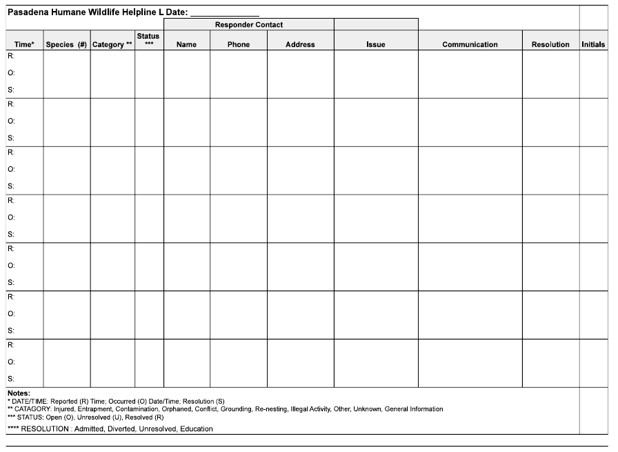

The Helpline log sheet is used to record incidents. Alternatively, incidents can be entered directly into WRMD's [Hotline Incident](WRMD-How-to-Create-a-Hotline-Incident).

**Contents**

- [Important Notes to Write](#important-notes-to-write)
- [Columns](#columns)
  - [Time](#time)
  - [Species (#)](#species-)
  - [Category](#category)
    - [Injured](#injured)
    - [Entrapment](#entrapment)
    - [Contamination](#contamination)
    - [Orphaned](#orphaned)
    - [Conflict](#conflict)
    - [Grounding](#grounding)
    - [Re-nesting (a.k.a. reunite)](#re-nesting-aka-reunite)
    - [Illegal Activity](#illegal-activity)
    - [General Information](#general-information)
    - [Unknown](#unknown)
    - [Other](#other)
  - [Status](#status)
  - [Name](#name)
  - [Phone](#phone)
  - [Address](#address)
  - [Issue](#issue)
  - [Communication](#communication)
  - [Resolution](#resolution)
  - [Initials](#initials)

# Important Notes to Write

Write "Page # of #" at the top of the sheet. Fill in the current date.

# Columns

Incidents are listed by rows. Each column header is explained below.

## Time

Date/time the incident was received.

- Reported Time (R)
- Occurred Date/Time (O)
- Resolution (S)

## Species (#)

The animal species and the quantity in parenthesis.

## Category

Write the type of incident:

### Injured

Any animal that has physical trauma and/or displaying symptoms of a disease or illness. 

**Typical Communication:**
- Gather information about the situation and determine if intervention is necessary

**Typical Resolution:**
- Admitted - pending or euth
- Diverted - sent to other agency
- Diverted - not gravely injured

*Example:*
- *Hawk with fractured humerus*
- *Raccoon with abnormal neurological symptoms*
- *Coyote with mange*

### Entrapment

Any animal that is in a state of being caught or in a trap, that requires personnel to physically release the animal. 

**Typical Communication:**
- If in service area, send officer to pick up

**Typical Resolution:**
- Admitted - pending, euth, or resolve in field
- Diverted - sent to other agency

*Example:*
- *Skunk stuck in humane trap (officers will go out to show how to open once)*
- *Snake stuck on sticky trap*
- *Opossum tangled in garden netting*

### Contamination

Any animal that is affected by an unnatural or undesirable element to its physical body in which it will require a wash or bathe. 

**Typical Communication:**
- Gather information and determine if intervention is necessary, send officer if in service area

**Typical Resolution:**
- Admitted - pending 
- Diverted - refer to another agency 

*Example:*
- *Mockingbird affected by glue trap (if currently stuck to the trap, see “entrapment”)*
- *Gull covered in cooking oil*

### Orphaned

Any baby animal in which has no parental care and/or attempts to reunite have been unsuccessful.

**Typical Communication:**
- Ensure animal is truly orphaned, attempt to send to other rehabber, or send officer to pick up if in service area

**Typical Resolution:**
- Admitted - pending or euth
- Diverted - refer to other agency

**Example:**
- *Baby squirrel found alone and attempts to reunite with mom have been unsuccessful*
- *Nestling bird that has been kicked out of nest and parent refuses to care for it*
- *Opossum smaller than dollar bill (excluding tail)*

### Conflict

Any interaction between people and wildlife.

**Typical Communication:**
- Refer to website information, provide educational materials for how to coexist

**Typical Resolution:**
- Education (changed from “humane deterrent”)

*Example:*
- *Raccoon eating cat food from RPs feral cat feeding station, RP wants raccoon removed*
- *Animal living under house/shed/in attic, etc*
- *Complaints about neighbors feeding coyotes*

### Grounding

Otherwise healthy young animals on ground, not flying away or avoiding capture and old enough to be on their own.

**Typical Communication:**
- Advise to leave alone, “Do Not Disturb” messaging

**Typical Resolution:**
- Diverted - Not gravely injured

*Example:*
- *Fledgling Band-Tailed Pigeon found under tree flapping wings but unable to take off*
- *Poorwill in torpor*
- *Stunned window strike in first 24 hours*

### Re-nesting (a.k.a. reunite)

Young animal found on ground without parent in sight, appropriate species to attempt reunite.

**Typical communication:**
- Explain how to attempt a reunite 

**Typical Resolution:**
- Diverted - left parent to care for

*Example:*
- *Nestling pigeon found on ground - build a makeshift nest and attempt to reunite*
- *Baby bunnies with ears down found without mom - place back in nest with tic-tac-toe sticks on top*

### Illegal Activity

An action towards an animal that is a violation of the law.

**Typical Communication:**
- Depends on call but all illegal activity should be reported to CDFW, 1-888-334-CalTIP

**Typical Resolution:**
- Education

*Example:*
- *Man shoots deer with bow and arrow in off season/without permit*

### General Information

Vague questions directed to the hotline which do not require advice or reportings of an animal in need. The only purpose of contacting the hotline was for information. 

**Typical Resolution:**
- Education

*Example:*
- *Hotline Hours*
- *Update on an animal*
- *List of other rehabilitation centers*
- *Other non-wildlife related information*

### Unknown

Any vague text messages directed to the hotline in which no further information could be received 

**Typical Resolution:**
- Unresolved

*Example:*
- *Person texted overnight about a skunk on the road and they do not reply to our response*

### Other

Any questions or concerns directed to the hotline which do not fall into any category from above.

*Example:*
- *Dead animal pickup request*
- *Typical Resolution*
- *Admitted - DOA*
- *Education*

## Status

Write the final status of the incident when completed or by the end of the shift:

- **Open (O):** Incident is ongoing and further communication is expected.
- **Unresolved (U):** RP did not reply, no actions taken, etc.
- **Resolved (R):** Incident closed with no further action needed.

## Name

RP's full name.

## Phone

RP's phone number.

## Address

Where the animal was found or incident occurred.

## Issue

Describe the problem or situation.

## Communication

The information provided to the RP. This can include any final steps taken (e.g., ACO was dispatched).

## Resolution

Write the resolution of the incident when completed or by the end of the shift:

- **Admitted:** ACO dispatched or animal was dropped off.
- **Unresolved:** RP did not reply, no actions taken, etc.
- **Education:** Information was provided to RP with no further action needed.
- **Diverted:** Any resolution that does not fall under one of the above (e.g., out of service area).

## Initials

Helpline responder's initials.