**Contents**

- [Overview](#overview)
- [Layout](#layout)
  - [1. Navigation Menu](#1-navigation-menu)
  - [2. Pages](#2-pages)
  - [3. Quick Links](#3-quick-links)
  - [4. GitHub Search Bar](#4-github-search-bar)
- [Issues](#issues)
- [Edit the Wiki](#edit-the-wiki)

# Overview

GitHub is a website typically used by developers to store, share, and collaborate on code. Each project is stored in a "repository".

The Wiki is stored in the `Wildlife` repository which is owned by the account, `Pasadena-Humane`.

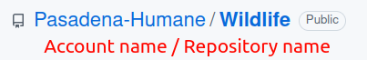

# Layout

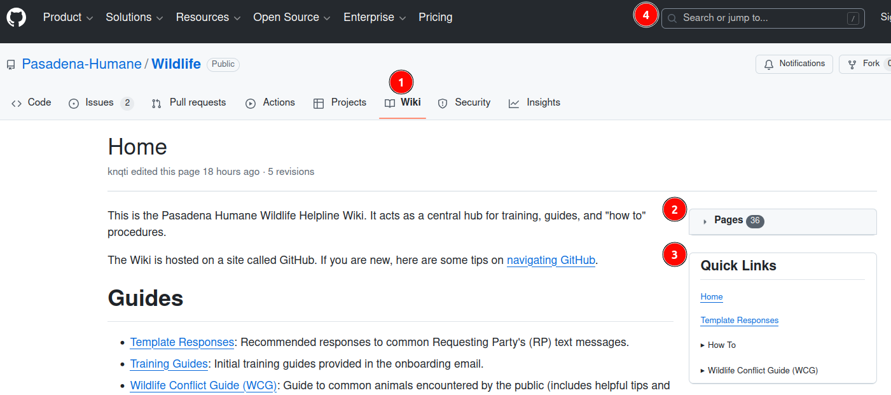

## 1. Navigation Menu

The top menu bar is the Navigation Menu. `Wiki` is the primary section. Clicking it takes you to the Home page.

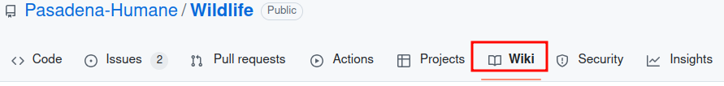

[`Issues`](#issues) is the only other section you might use. The rest can be ignored.

## 2. Pages

On the right side, above `Quick Links`, is the `Pages` menu. 

**NOTE:** The triangle symbol on the left indicates a drop-down list that can be expanded when clicked.

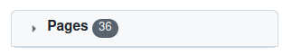

Click it to display all the Wiki's pages, sorted in alphabetical order (`Home` is always first).

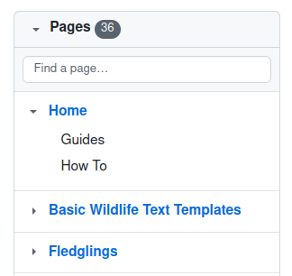

You can type into the search bar to find specific pages. Clicking the result will take you to that page or section.

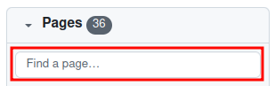

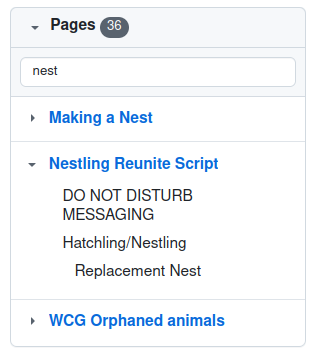

Searching `Pages` only looks at titles/headers. For a more in-depth search that also looks at content, use the [`GitHub Search Bar`](#4-github-search-bar).

## 3. Quick Links

On the right side, below `Pages`, is the `Quick Links` menu.

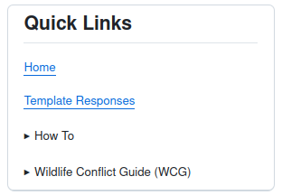

These are links to frequently used resources.

## 4. GitHub Search Bar

At the very top, to the right, is the `GitHub Search Bar`. It provides in-depth search results including content within pages.

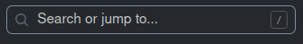

Clicking it, or pressing the forward-slash `/` key, expands the search bar. By default, it will search the current repository you are in.

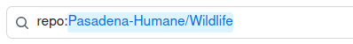

When you search for something, it may show 0 results. However, it should also show a link to the Wiki results. Click that link.

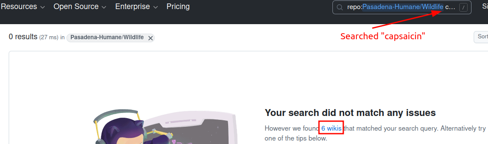

It will then take you to a page listing out the pages that include the search term.

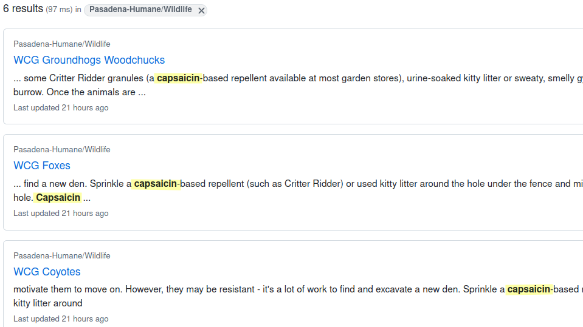

# Issues

If you find any mistakes, problems, or have suggestions, please go to the `Issues` section in the Navigation Menu.

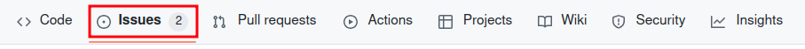

Click `New issue`.

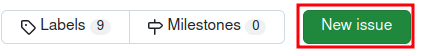

Fill out the title, description, and then click `Submit new issue`.

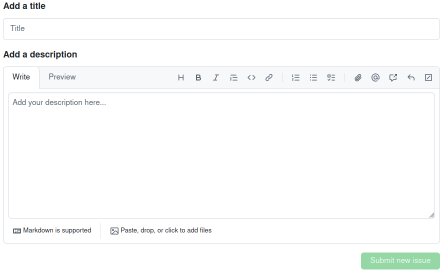

# Edit the Wiki

The simplest way to edit is to make the changes within the GitHub repository.

1. Go to the page you want to edit. In the top-right corner, click `Edit`.

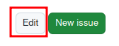

2. You will be taken to the editing page. 

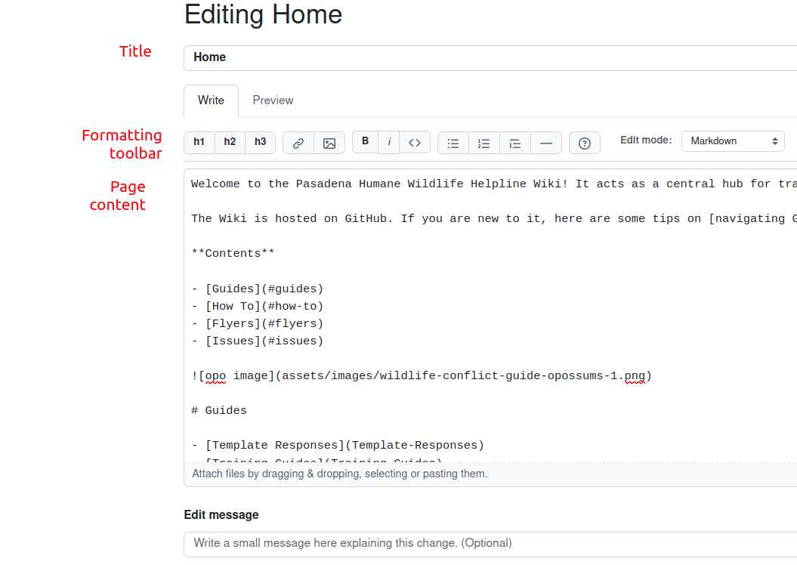

By default, you will be in the `Write` tab. Notice we use [Markdown](https://docs.github.com/en/get-started/writing-on-github/getting-started-with-writing-and-formatting-on-github/basic-writing-and-formatting-syntax) as the formatting language (similar to Slack). Use the formatting toolbar if you are unfamiliar with Markdown.

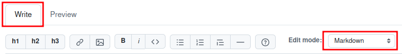

Click the `Preview` tab to see a preview of how the page will be displayed.

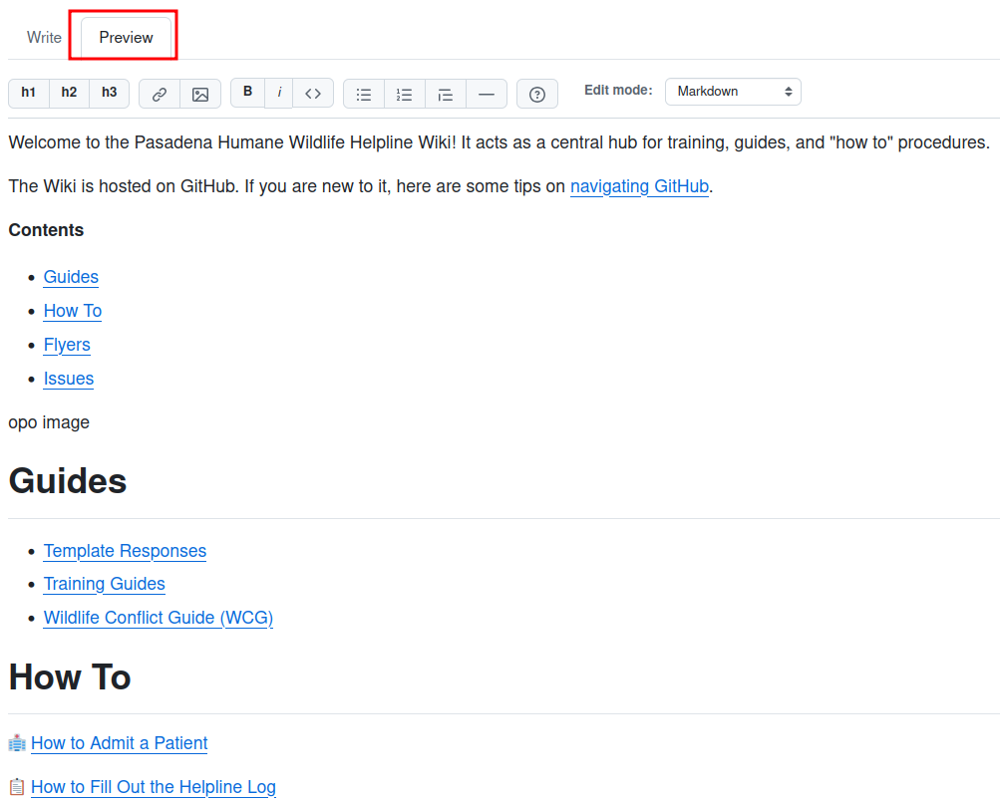

**NOTE:** Images embedded with relative links will not display in `Preview` (they will display normally once live). However, images embedded with absolute links will display in `Preview` (i.e., dragging & dropping or copying & pasting images into the page content box).

3. Before saving your edits, it is good practice to write an `Edit message`. This helps keep track of edits and is useful when reviewing the [history of changes](https://docs.github.com/en/communities/documenting-your-project-with-wikis/viewing-a-wikis-history-of-changes).

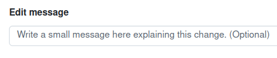

4. Click `Save page`. Your edits are now live!

