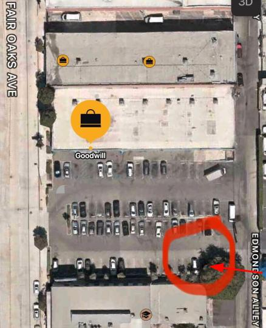
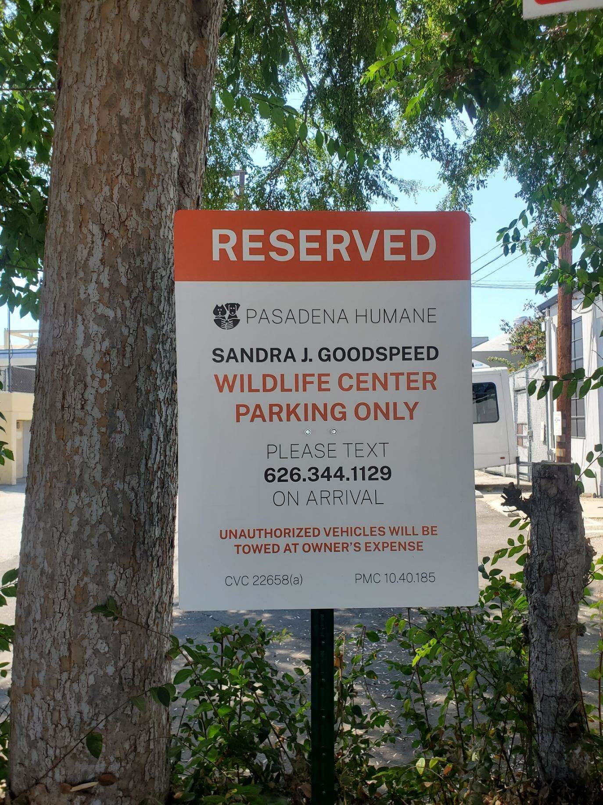
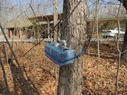
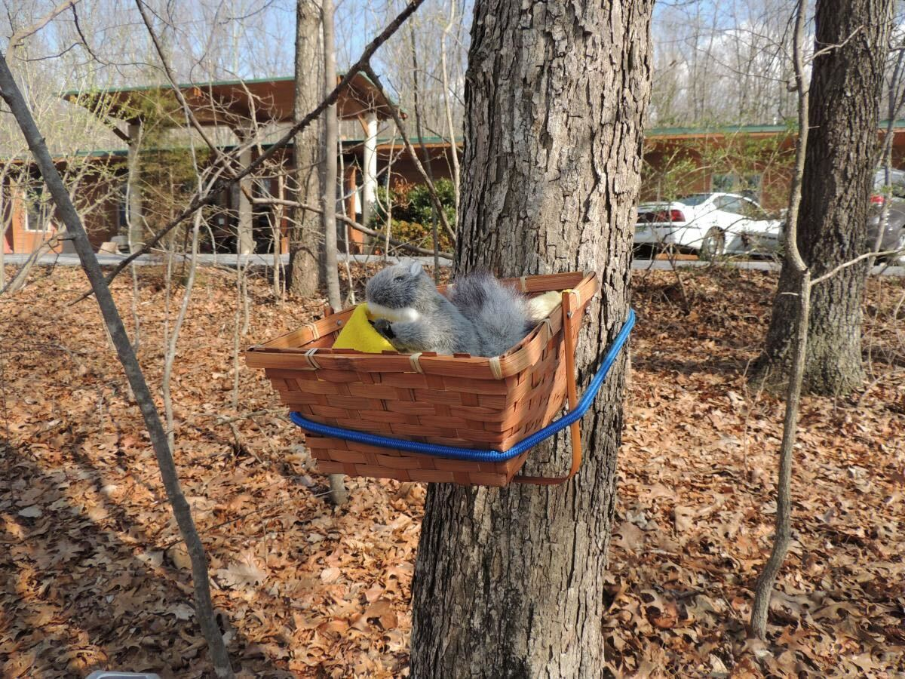
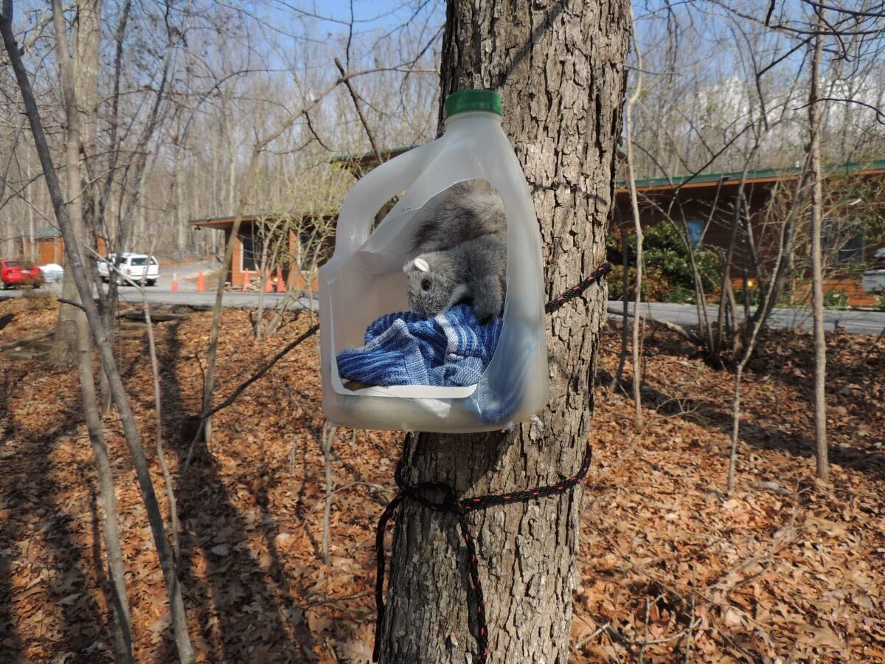

These are template responses to common Requesting Party's (RP) text messages. Customize them as needed.

**Contents**
- [First Response - Distressed Animal](#first-response---distressed-animal)
- [After Hours](#after-hours)
- [Animals in Crawl Spaces/Attics/Eviction](#animals-in-crawl-spacesatticseviction)
- [Avian Influenza](#avian-influenza)
- [Bear Info](#bear-info)
- [Bee Keepers](#bee-keepers)
- [Bird](#bird)
  - [Nestling General](#nestling-general)
  - [Nestling Reunite](#nestling-reunite)
  - [Fledgling Response](#fledgling-response)
  - [Window Strike Bird (with no obvious injuries)](#window-strike-bird-with-no-obvious-injuries)
- [Bobcat Info](#bobcat-info)
- [Coyote Info](#coyote-info)
  - [Coyote Still Mobile](#coyote-still-mobile)
  - [Coyote With Mange](#coyote-with-mange)
- [Dead or Deceased Pickup](#dead-or-deceased-pickup)
- [Deer Still Mobile](#deer-still-mobile)
- [Donate](#donate)
- [Ducks (Mallards)](#ducks-mallards)
  - [Ducks in Yards and Pools](#ducks-in-yards-and-pools)
  - [Legal Protections](#legal-protections)
- [ETA](#ETA)
- [Humane Exclusion Service](#humane-exclusion-service)
- [Humane Pest Control - Rats](#humane-pest-control---rats)
- [If RP Only Left Voicemail](#if-rp-only-left-voicemail)
- [Illegal for Public to Rehab](#illegal-for-public-to-rehab)
- [Illegal to Relocate](#illegal-to-relocate)
- [Meet in Goodwill Parking](#meet-in-goodwill-parking)
- [Not in Our Service Area](#not-in-our-service-area)
- [Opossum](#opossum)
  - [Dollar bill size and larger (if uninjured)](#dollar-bill-size-and-larger-if-uninjured)
- [Peafowl Deterrents](#peafowl-deterrents)
- [Predation Event](#predation-event)
- [Raccoon](#raccoon)
  - [Baby (if uninjured)](#baby-if-uninjured)
- [Rabbit RHDV](#rabbit-rhdv)
- [Rats or Mice](#rats-or-mice)
- [Skunk](#skunk)
  - [Baby (if uninjured)](#baby-if-uninjured-1)
- [Snake ID](#snake-id)
- [Squirrel](#squirrel)
  - [If found in the AM](#if-found-in-the-am)
  - [If found in the late PM and it looks fine](#if-found-in-the-late-pm-and-it-looks-fine)
- [Update on Animal](#update-on-animal)
- [Will You Treat the Animal or Just Kill It?](#will-you-treat-the-animal-or-just-kill-it)

# After Hours

```
Hello, thank you for reaching out to Pasadena Humane Wildlife Helpline. It seems you have messaged us outside of our hours. We are open from 9:30am to 5:30pm daily. Please help us determine what is best for the animal by texting us a clear photo and giving as much information as possible:

1. What is your first and last name?
2. What is the address where the animal was found (or closest cross-streets)?
3. Do you see any obvious bleeding or other injuries (please include photos and videos that show this)?
4. Is the animal moving? Describe its movements.
5. Approximately how big is the animal?
6. How long have you been observing it?

We will respond to your message when we return. In most cases, it is best to refrain from intervention until a wildlife expert is available. Please see our website for information about baby animals and other wildlife concerns at `https://pasadenahumane.org/services/wildlife/`. For urgent help outside of our normal hours you may contact (626) 792-7151 x970.
```

# Animals in Crawl Spaces/Attics/Eviction

See [Humane Exclusion Service](#humane-exclusion-service).

# Avian Influenza

Due to the increase of Highly Pathogenic Avian Influenza (HPAI) cases, we are admitting waterfowl for euthanasia only. You can read more about HPAI here `https://calepa.ca.gov/disaster/ainfluenza/`

1. **Not Gravely Injured Waterfowls**

    ```
    Hello, thank you for reaching out to Pasadena Humane Wildlife Helpline. Our policy is to only intervene when absolutely necessary, especially with highly stress-prone species. There is also a highly pathogenic avian influenza throughout California, so we are even MORE careful about which birds we are admitting. It has been detected in mainly waterfowl and some scavenging species (like raptors and corvids). Since the condition of this animal is not severe enough to necessitate humane euthanasia, we recommend the animal be left alone. We would like to give it the opportunity to recover on its own. If its condition deteriorates further, please contact us again. You may also contact IBR (International Bird Rescue) at `(310) 514-2573` to see if they have the capacity to intake it.
    ```

2. **Healthy Orphaned Waterfowl (not including Mallards)**

   a. Try to REUNITE

   b. Intake if reunion was unsuccessful

# Bear Info
```
Thank you for reaching out about bears in your community. This flyer includes information and helpful tips: https://pasadenahumane.org/wp-content/uploads/2023/04/23_4_Wildlife-Flyers_Web_Bear.pdf

Bears are native wildlife and are free to roam as determined under the jurisdiction of the Department of Fish and Wildlife; Pasadena Humane is not authorized to trap or relocate them. They are also a valuable part of our ecosystem. We are not authorized to intervene with bears without the direction of Fish and Wildlife.

Bears go where there are resources, and their behavior changes based on how humans react to them - so it is imperative we avoid intentionally or unintentionally providing food, water, or shelter to them.

Additionally, consistently hazing bears whenever they are on our properties or near people is the only sustainable and effective way to alter unwanted behavior. We should take every opportunity to make them uncomfortable by hazing them with things like loud noises (i.e., air horns, banging pots and pans), squirting them with a hose, quickly opening and closing an umbrella, etc.

In Southern California, black bears do not naturally see humans (even children) as prey - their natural instinct is to fear humans. Children should be taught how to haze. Passive hazing devices like motion-sensing sprinklers and bear fencing help deter bears and other wildlife when you are not home, but the most effective thing is to make sure there are no food, water, or shelter resources that would attract the bear to the property in the first place. 

Small children and pets must be supervised at all times while outside, dogs kept close by and on 6 feet or shorter leashes, and cats be kept indoors or provided an enclosed, predator-proof catio for safety.

You can email wildlife@pasadenahumane.org with any further questions. Thank you for your consideration and support.
```
# Bee Keepers
```
Thank you for reaching out about bees in your community. Here is a list of local service providers. Please note that they will likely charge a fee for this service.

Dave Williams
- Tel: 626-791-8979
- Cell: 626-808-1771
- Email: baileystream@gmail.com

Noah's Farm (Hossein Saeedy)
- Tel: 626-893-4355
- Email: zerangsaveh@yahoo.com

Anthony & Valeriy Barkanov
- Tel: 626-775-4207
- Cell: 714-469-8721
- Email: vbarkanov@msn.com

LeRoy Steese
- Tel: 818-282-3208
- Tel: 818-282-3209 
- Email: Beekeepersteese@gmail.com

Save My Bees (Byron Levy)
- Tel: 707-888-4644
- Email: hello@savemybees.com
- Web: https://www.savemybees.com

Lea and Leon Johnson
- Tel: 310-924-2168
- Email: leajohnson@yahoo.com
```

# Bird

## Nestling General

Thank you for the pictures. This is a healthy nestling [species]. If you haven't done so yet, the best thing you can do for this animal is to reunite the baby back with its parents. The parents are able to provide round the clock care for the baby and they do a better job of taking care of it than any human could. Please follow this flowchart.

[insert [Baby Bird Flow Chart](assets/pdf/Baby-Bird-Flow-Chart-2021.pdf)]

## Nestling Reunite

Since this a nestling, the bird’s legs might not be strong enough to stand or walk on its own. The best thing for the bird right now is to re-nest it and see if its parents are still around. Please get a small container such as a box and line it with tissue paper and some twigs or leaves. Make sure to poke some holes on the bottom of the box for drainage. Place the makeshift nest with the baby bird on a nearby tree or tall bush - somewhere sturdy. You can tape the makeshift nest or use zip ties to secure it to the tree. If successful, the parents will move into that nest and continue to take care of the baby. Please watch from a distance (20+ ft) to see if any birds come back to the makeshift nest, but do not get too close as to scare the parents off and prevent them from returning. Most parents will only come back for a quick second to feed their babies then leave, so do not be alarmed if you do not see them. Please do not feed the baby and do not check up on it more than once every 2 hours or so as this will scare the parents away. Please let us know if the baby’s condition or attitude changes or if you have any other questions.

*More details in the [Nestling Reunite Script](Nestling-Reunite-Script).*

*More details in [Making a Nest](Making-a-Nest).*

## Fledgling Response

Thank you for the pictures. This is a fledgling. At this age they start hopping out of their nest and learning how to fly. These fledglings may stay on the ground for up to 2 weeks before they gain the muscles and learn to fly away. The parents are still around to feed and hydrate it and take care of it but this only take a few seconds so it’s easy to miss. Please, do not feed the baby and do not check up on it often as this will scare the parents away, but please let us know if the fledgling's condition deteriorates, if it is closing its eyes for long periods, or if it can no longer sit up. You should release it back under some or natural covering as close as you can near where you found it.

## Window Strike Bird (with no obvious injuries)

*Okay to admit for supportive care.*

Thank you for the information. We will dispatch an Animal Control Officer for pick-up.

# Bobcat Info

Thank you for reaching out about bobcats in your community. This flyer includes information and helpful tips: `https://pasadenahumane.org/wp-content/uploads/2023/04/23_4_Wildlife-Flyers_Web_Bobcat.pdf`

Bobcats are native wildlife and are free to roam as determined under the jurisdiction of the Department of Fish and Wildlife; Pasadena Humane is not authorized to trap or relocate them. They are also a valuable part of our ecosystem, keeping rodent populations down and providing free carrion removal, among other benefits. Bobcats are opportunistic carnivores and will eat whatever they can catch. Although they prefer rabbits and rodents, bobcats will also eat small reptiles, birds, feral cats, eggs, and occasionally deer and small livestock. Bobcats do most of their hunting at dawn, dusk, and through the night, but will come out whenever it is most convenient for them to find resources.

Bobcats go where there are resources, and their behavior changes based on how humans react to them - so it is imperative we avoid intentionally or unintentionally providing food, water, or shelter to bobcats.

Hazing bobcats whenever they are on our properties or near people is the only sustainable and effective way to alter unwanted behavior. We should take every opportunity to make bobcats uncomfortable around humans by hazing them with things like loud noises (i.e. air horns, banging pots and pans), squirting them with a hose, quickly opening and closing an umbrella, etc.

In Southern California, bobcats only grow on average to around 20 lbs and do not naturally see humans (even children) as prey - their natural instinct is to fear humans and tend to be solitary and shy. Children should be taught how to haze. Passive hazing devices like motion-sensing sprinklers and coyote rollers for fences help deter bobcats and other wildlife when you are not home.

We recommend children and pets be supervised at all times while outside, dogs be kept close by and on 6 ft or shorter leashes, and cats be kept indoors or provided an enclosed catio for safety.

You can email `wildlife@pasadenahumane.org` with any further questions. Thank you for your consideration and support.

# Coyote Info

Thank you for reaching out about coyotes in your community. This flyer includes information and helpful tips: `https://pasadenahumane.org/wp-content/uploads/2023/04/23_4_Wildlife-Flyers_Web_Coyote.pdf`

Coyotes are native wildlife and are free to roam as determined under the jurisdiction of the Department of Fish and Wildlife; they are a normal part of Pasadena's urban ecosystem. Pasadena Humane is not authorized to trap or relocate them. They are also a valuable part of our environment, keeping rodent populations down and providing free carrion removal, among other benefits. Removing coyotes from our local ecosystem is not feasible nor would it be ecological beneficial.

Coyotes go where there are resources, and their behavior changes based on how humans react to them - so, we must avoid intentionally or unintentionally providing food, water, or shelter to coyotes. You are responsible for your safety and the safety of your pets and family. This includes educating yourself on what is normal behavior and what to do when you encounter coyotes. We are here to help with this.

Consistently hazing coyotes whenever they are on our properties or near people continuously until they have left the area is the only sustainable and effective way to alter unwanted behavior. We should take every opportunity to make coyotes uncomfortable by hazing them with things like loud noises (i.e. air horns, banging pots and pans), squirting them with a hose, quickly opening and closing an umbrella, etc. Never turn your back or run from coyotes. 

In Southern California, coyotes only grow up to about 35 lbs and do not naturally see humans (even children) as prey - their instinct is to fear humans. Children should be taught how to haze coyotes; children and pets must be supervised at all times while outside; dogs should always be kept close by and on 6ft or shorter leashes when outside; cats should be kept indoors or provided an enclosed catio for safety. Passive hazing devices like motion-sensing sprinklers and coyote rollers atop 6ft fences help deter coyotes and other wildlife when you are not home.

`Pasadenahumane.org/service/wildlife` has many resources including a coyote flyer with helpful tips on how to haze coyotes and prevent them from becoming too comfortable around humans. In addition, you can watch our Coyote Safety webinar recording at any time.

You can participate in community science by reporting all coyote sightings and encounters at `https://ucanr.edu/sites/CoyoteCacher/`
And finally, for any further questions please email `wildlife@pasadenahumane.org`.

If there is a human emergency, call 911. We thank you for your consideration and support.

## Coyote Still Mobile

Hi thanks for contacting Pasadena Humane Wildlife Helpline. CA Fish and Wildlife does not permit us to trap mobile wildlife, you may call them directly to report concerns about this animal at `(858) 467-4201` but it is unlikely they will intervene. Capture is highly stressful and poses a risk to the animal and our staff. If the coyote’s condition deteriorates such that it is unable to get away, loses function of 2 or more limbs, and is unresponsive to hazing (approaching the animal with arms waving or spraying with water), please contact us again at this number or our dispatch line. The hours for this wildlife helpline are 9:30am-5:30pm. Our after-hours dispatch line is `(626) 792-7151 x970`.

## Coyote With Mange

Hi thanks for contacting Pasadena Humane Wildlife Helpline. We do not have the authority or resources to treat these animals in the field and we are not permitted to trap or capture animals that are still mobile per CA Dept of Fish and Wildlife. If you would like to call CDFW directly to report concerns about this animal you can reach the regional office at `(858) 467-4201` but it is unlikely they will intervene. Capture is highly stressful and poses a risk to the animal and our staff. Additionally, mange is endemic to the coyote population and they can sometimes recover without intervention or targeted treatment. If the coyote's condition deteriorates to the point that they can no longer walk or stand, please call our dispatch at `(626) 792-7151 x970`. In the meantime, please avoid the animal as much as possible, do not feed it or supply any resources, and haze it if it begins to approach people. Let us know if you have any further questions.

# Dead or Deceased Pickup

Thank you for contacting Pasadena Humane Wildlife Helpline. You can dispose of the body yourself in a trash bag, bury it, place in compost, or if you would like to have someone from our organization pick up, please call 626-792-7151 ext. 265 to be connected to our DOA Pickup Request line, where you can leave the information for deceased animal pickup in a voicemail. 

# Deer Still Mobile

Hi thanks for contacting Pasadena Humane Wildlife Helpline. Unfortunately, we are unable to send an officer as the deer is still mobile. We are not permitted by CA Dept of Fish and Wildlife to trap, relocate, or rehab adult deer. Below is a link with some more information. Please contact us if its condition deteriorates and it is no longer mobile. Thank you for your care and compassion for wildlife. 

`https://www.nativeanimalrescue.org/found-an-animal/deer/`

# Donate

Thank you for assisting wildlife in distress. Your ongoing support is vital to the wildlife in our community. As a non-profit organization, we rely on donations to care for the thousands of wild animals who need our care each year. Please consider giving today to help ensure we can continue this critical program: `http://pasadenahumane.org/supportwildlife`.

# Ducks (Mallards)

## Ducks in Yards and Pools

Your yard or pool might be an inviting place for ducks to rest or build a nest. Water features, vegetation, and quiet spaces can make it an ideal spot for them to raise a brood. Below are tips for how to respond when ducks have made your yard or pool their temporary home.

**If You Have Nesting Ducks in Your Yard:**

- Enjoy watching the wildlife and observe their behavior from a distance.
- Keep pets and children away from the nest.
- Avoid disturbing the ducks during the nesting period.

**If You Want to Discourage Nesting or Swimming in Pools:**

- Do **not** destroy any nest that contains eggs. This is illegal without a federal permit.
- Do **not** leave food out or feed ducks - this encourages them to stay.
- Watch for signs of nest-searching (pairs of ducks or a female quacking and exploring during early evenings): if seen, gently scare them off before they start nesting.
- Let your dog patrol the yard before a nest is built (never allow dogs to chase ducklings or disturb an active nest).
- If you find an inactive (empty) nest, you may remove it, but be prepared to do so multiple times as ducks may try again.
- Cover your pool when not in use.
- Place brightly colored inflatable pool toys in the water-ducks tend to avoid pools with unfamiliar objects.
- Trim overgrown grass and low shrubs where ducks might nest.

**If You Discover a Duck Nest:**

- If you’re okay with the ducks nesting, observe from a distance and allow nature to take its course.
- If you do not want ducks nesting, remove the nest before it contains eggs.
- Once eggs are laid, the nest is legally protected and may not be disturbed.

**If There Are Ducks in Your Pool:**

- Ducklings can’t fly or step out of pools with tall ledges and may drown if they can’t get out.
- Place a non-slippery ramp, towel, or soft board in the pool to help ducklings climb out safely.
- If Ducks Are Trapped in an Enclosed Yard:
- Open a gate or path so the ducks can leave on their own.
- Gently guide them toward the exit, but do not scare the mother away from her ducklings.
- If you cannot safely guide the ducks out, contact a licensed wildlife rehabilitator for help.

**Nests with Eggs or Ducklings Are Protected:**

- Once eggs are laid, the nest is active and federally protected.
- Ducklings usually hatch after about 25 days. Within 24 hours of hatching, the mother will lead them to water.
- During this time, keep pets and children away from the duck family.

## Legal Protections

Ducks/Mallards are protected under the Migratory Bird Treaty Act of 1918.

It is illegal to:

- Take, possess, relocate, sell, or purchase Mallards or any of their parts (feathers, eggs, nests, etc.) without a permit.
- Disturb or destroy active nests (those with eggs or chicks) without a permit from the U.S. Fish and Wildlife Service.
- The U.S. Fish and Wildlife Service does not issue permits to remove Mallards, their eggs, or active nests from pools or enclosed yards.

If You See Injured or Distressed Ducks:

- If a duck appears injured (limping, unable to fly, bleeding, or stuck), or if ducklings are orphaned or abandoned, please let us know.
- Do not attempt to capture or care for injured ducks yourself unless instructed to do so - it’s easy to accidentally cause more harm.

# ETA

Unfortunately, we are unable to give an ETA since it depends on officer location and call volume, but your request is in. If you need to leave, you may safely place the animal in a box on your porch (or another accessible spot) for pickup. If you can’t confine it, let us know when you’ll be back so we can send an officer then.

# First Response - Distressed Animal

Hello, thank you for reaching out to the Pasadena Humane Wildlife Helpline. Our team is currently working hard assisting other callers and attending to animals in care. We will get back to you as soon as possible.

If you are contacting us about an injured or sick wild animal, please fill out our animal report form so we can determine the best next steps: `https://wrmd.org/embed/public-animal-report-form/GVJ8x8qoqWPeuIWdqqCMSqwTLPE8am848jsF8LUhrJLcIlDE/`

PLease text us the confirmation code once completed. Thank you for your help. We will be in touch as soon as possible.

# Humane Exclusion Service

Hello, thank you for reaching out. The Pasadena Humane Wildlife Team is now offering a humane wildlife exclusion service where we help community members with wildlife conflict issues as an alternative to conventional pest control companies which often trap and euthanize wildlife. It's important for you to know that we do not trap and relocate wildlife, but can assist with deterring and humanely evicting wildlife from property. We provide a detailed consultation after an initial inspection of the property, allowing us to give precise and accurate advice that is specific to your needs. All situations are different, and we want to find the best solution for you. The initial inspection cost for a site visit in our service area is $145. You can find a detailed breakdown of services on our website `https://pasadenahumane.org/services/wildlife/humane-wildlife-exclusion/`

If you are looking for advice on how to handle an exclusion yourself, please refer to `https://awces.com/self-help` where you can find great information on DIY solutions. We do not, unfortunately, have the extra time and resources to spend on the phone giving DIY advice. 

Please let us know if you have additional questions. To request an initial site inspection, please fill out this form: `https://forms.cloud.microsoft/r/Hf1hfpyEW7`

# Humane Pest Control - Rats

For the cost of an initial inspection, The Pasadena Humane Wildlife Team can consult on rats and rodent exclusion, but we do not have the capacity to do the full structure seal and exclusion installation. We recommend Humane Pest Control Inc for these services: `https://humanepestpro.com` or call 844-PEST-PRO. 

Thank you for addressing your conflicts with compassion!

# If RP Only Left Voicemail

Hi we received your voicemail about _____. Thank you so much for reaching out, we apologize for missing your call. We typically check voicemails once per day. Our helpline is primarily a text message based system as our team is working hard attending to animals currently in care. Please reply to this text message for the fastest response. If you are unable to text for any reason, please call again and let us know in your voicemail and we will return your call as soon as possible. 

# Illegal for Public to Rehab

California Code of Regulations, Title 14, Section 679 gives the public 48 hours to contact the Department of Fish and Wildlife or a licensed rehabilitator to place an injured or orphaned wild animal. Keeping wild animals beyond that window is not legal, nor is it in the best interest of the animal. Licensed wildlife rehabilitators hold specific permits from Fish and Wildlife that allow them to care for wildlife in captivity. Those permits exist because captivity is extremely stressful for wild animals, and they need species-specific care. Even with the best intentions, well-meaning rescuers can unintentionally cause a wild animal to die from something called capture myopathy, a stress response to human handling.

Please locate and contact a licensed wildlife rehabilitator as soon as possible. Below is a list of permit-holding centers in your area. Please understand that no licensed wildlife facility will allow an animal to continue suffering.

`https://wildlife.ca.gov/Conservation/Laboratories/Wildlife-Health/Rehab/Facilities`

# Illegal to Relocate

It is illegal to relocate wildlife in the state of California per Section 465.5 of 14 of the California Code of Regulations. The most appropriate thing to do is to release the animal on the same property where it was trapped. Let us know if you need assistance with this. 

# Meet in Goodwill Parking

Since you will be in close quarters with a wild animal, please keep this in mind: in order to minimize any additional stress please refrain from playing loud music, talking should be kept to a whisper, keep the animal in an enclosed, covered container and refrain from peeking at it. If possible, please place the animal in a secure location such as the passenger side floor in the vehicle to prevent constant/sudden movements during the car ride. Do not smoke or bring along pets while transporting the animal. 

Please head to the Goodwill parking lot just behind Pasadena Humane: 340 S Fair Oaks, Pasadena, CA 91105

We have two reserved parking spots in the southeast section of the Goodwill parking lot for our Wildlife Department. Stay in your car when you arrive and text this number. Someone will be out to meet you as soon as they are available. Thank you for your willingness to help our wild neighbors!





# Not in Our Service Area

We can only accept animals from inside our 11 service cities at this time. You can read more about it here: `https://pasadenahumane.org/services/animal-care-and-control/animal-control`

We suggest finding another licensed rehabilitation center by clicking the following link: `https://wildlife.ca.gov/Conservation/Laboratories/Wildlife-Health/Rehab/Facilities`

Below is also a list of animal shelters in Los Angeles County where you can find the appropriate contact for animal control services: `https://acwm.lacounty.gov/animal-control-shelter-services/`

You may also try contacting your local exotic veterinary clinic.

# Opossum 

## Dollar bill size and larger (if uninjured)

Great news! This opossum is old enough to be on its own. This is the age that they will start to fall off of mom's back and venture off on their own. You can place the opossum back outside under a bush or other coverage so they can continue exploring their surroundings and grow.

*Examples of measuring with a dollar bill:*


# Peafowl Deterrents

Thank you for reaching about peafowls in your community. This flyer includes information and helpful tips: `https://pasadenahumane.org/wp-content/uploads/2023/04/23_4_Wildlife-Flyers_Web_Peafowl.pdf`

- Peafowls do not like water: Water is one of the best-known deterrents for peafowl. The intermittent use of sprinklers or a hose with a jet nozzle will act as a negative reinforcement for the birds. Also, consider a motion sensor activated water spray, such as the Scarecrow, which is battery operated and covers an area of about 35 feet and can be connected to your garden hose. It's available online or at garden stores.

- Avoid planting young tender seedlings in areas you do not want peafowl to visit or cover the plants until they're well established. There are also a variety of plants peafowl do NOT eat/like and can help with deterrence. You can read more about it here: `https://www.rpvca.gov/510/Dealing-with-Peafowl#:~:text=Cat%20repellent%20and%20mothballs%20around,around%20the%20property%20and%20neighborhood`

- Peafowls will avoid certain repellents: Cat repellent around planting beds, porches, and along walkways may be an effective means of repelling peafowl. Caution should be used so as not to allow young children or animals to ingest the repellents.

- Peafowls are afraid of dogs: Walk your dog around the property and neighborhood.

- Peafowls like to eat seeds, bugs, and worms: Avoid open compost and manure sacks. If you wish to compost, use a covered compost bin and keep the composting area clean.•Peafowl like to eat wild birdseed, bread, and pet food. These are delectable treats to peafowl. Once they're hooked, it's difficult to wean them. It's a good idea to remove any leftover pet food immediately or feed pets indoors.
- Peafowls prefer to roost in safe areas, such as overhanging trees: Hire a certified Arborist to trim or thin overhanging trees in the fall and winter to avoid roosting.

# Predation Event

We understand it can be upsetting to witness a predation event, but these interactions are a natural part of a healthy ecosystem. For this reason, we do not intervene in native wildlife predation and allow these situations to unfold without human interference. If the predator has left the area with no sign of return after 30 mins, please reach out again and we can reassess. 

# Raccoon

## Baby (if uninjured)

Place the baby in a shaded area near where it was found and place a laundry basket over the baby raccoon. This prevents other animals from taking it and keeps the baby out of danger. Play some baby raccoon calls on a speaker and wait a few hours. Raccoons are nocturnal, so they are more active at night. Leave the baby out overnight to see if the mom will come back for it. The mom is able to lift the basket over to retrieve the baby. Please let us know if the baby's attitude changes. If the baby is still there tomorrow morning, please contact us after 9am.

# Rabbit RHDV

Due to Rabbit Hemorrhagic Disease Virus (RHDV), we’re unable to rehab wild rabbits at our center. Since our campus also houses domestic rabbits available for adoption in the shelter, the risk of spreading this highly contagious and often fatal virus is too great. Thank you for understanding. You can read more about it here `https://www.cdfa.ca.gov/AHFSS/Animal_Health/RHD.html`

# Rats or Mice

Thank you for calling about the mouse/rat you found. Pasadena Humane's Wildlife Center doesn't rehabilitate mice or rats, and neither do our partner wildlife rehab centers. If you're within our service area, we can accept the animal for humane euthanasia. If you're outside our service area, please surrender the animal to your local animal control or a local veterinarian to assist.

# Skunk

## Baby (if uninjured)

Place the baby in a shaded area near where it was found and place a light laundry basket over it. This prevents other animals from taking it and keeps the baby out of danger. Skunks are nocturnal, so they are more active at night but may try to find their babies in the day time. Leave the baby out overnight to see if the mom will come back for it. Do not feed the baby or take it inside but let us know if its attitude changes. If the baby is still there tomorrow morning, please contact us after 9am. Do not handle the skunk unless absolutely necessary and only then you must use thick gloves or a towel. Skunks are considered rabies vector species and any bites or scratches must be reported and treated by a medical professional as soon as possible.

# Snake ID

For helpline personnel: Review the following links to help identify the species of snake for the RP. Gopher snakes are often mistaken for rattlesnakes although they are almost harmless and very beneficial pest control. Dangerous venomous snakes have a large, wide head with cat-eye pupils in their eyes, and large scales on their body.

`https://californiaherps.com/identification/snakesid/common.html`

`https://californiaherps.com/snakes/snakespics.html`

`http://www.losangelessnakes.com`

# Squirrel

## If found in the AM

Please place the baby in a shoebox or similar container and place the box back as close to where the baby was found as reasonable. You can place a makeshift heating pad (warm rice-filled sock) in the box if you'd like, ensure it it not too hot by holding to your skin for 5-10 seconds. Using a bluetooth or phone speaker, play baby fox squirrel calls which can be found on youtube. Place the speaker near the baby for a few hours and do not disturb it. Many times the parent will return for the baby and carry it back to the nest. If the baby's condition declines or if the baby is still there by 4pm or so, please let us know.

## If found in the PM and it looks healthy

We would like to give the parents the chance to come back for their baby. Since there are a few hours of daylight left, please place the baby in a shoebox or similar container and place the box back as close to where the baby was found as reasonable. You can place a makeshift heating pad (warm rice-filled sock) in the box if you'd like, ensure it it not too hot by holding to your skin for 5-10 seconds. Using a bluetooth or phone speaker, play baby fox squirrel calls which can be found on youtube. Place the speaker near the baby for a few hours and do not disturb it. Many times the parent will return for the baby and carry it back to the nest. If the baby is still there when it is dark outside, you may bring the baby inside and place it in an enclosed box in a warm, quiet area away from pets and people. Refrain from interacting or handling it unless absolutely necessary. Place the baby outside again tomorrow morning shortly after sunrise to try again. Please contact us after 9:30am if the baby is still there. Please do not attempt to feed or water the squirrel. If its condition declines after hours please call dispatch at `626-792-7151 x970`.

*Shoe box/container examples:*







*Makeshift heating pad example:*


*Reunited examples:*


[Squirrel reunited video # 1](assets/videos/squirrel-reunite-1.MOV) (click to download)

[Squirrel reunited video # 2](assets/videos/squirrel-reunite-2.MOV) (click to download)

# Update on Animal

Hello, for updates please email `wildlife@pasadenahumane.org`. Please include your name, phone number, address the animal was found, and animal ID number. 

Your ID # is 

Please allow at least 7 days for a response as our staff primarily attends to the direct care of incoming patients.

# Will You Treat the Animal or Just Kill It?

Wild animals need to be examined and cared for by trained wildlife medical experts, such as our team, who have been licensed and permitted by State and Federal agencies. Our policy is to always put the animal's welfare above all else. All wildlife that comes to our facility receives a full medical exam by our team of Certified Wildlife Rehabilitators. With the help of our trained wildlife veterinarians, our team will provide the most appropriate medical treatment depending on the prognosis of the animal. Humane, compassionate euthanasia is just one of many treatments we are licensed and trained to provide to our patients, but we will not know what is most appropriate until we are able to do a full examination. Thank you for trying to help an animal in distress! For updates you can email `wildlife@pasadenahumane.org`