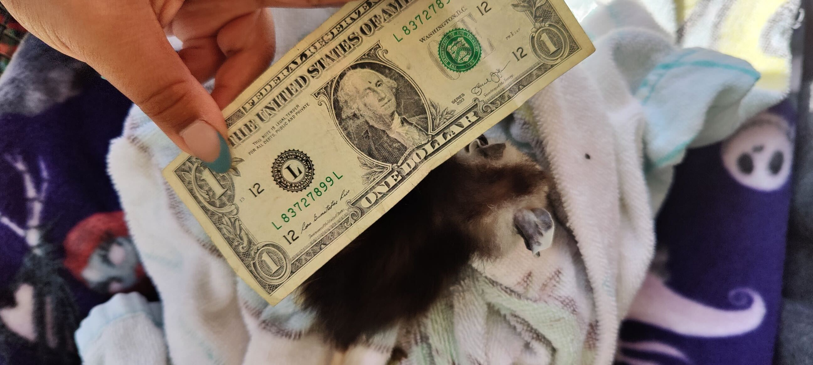
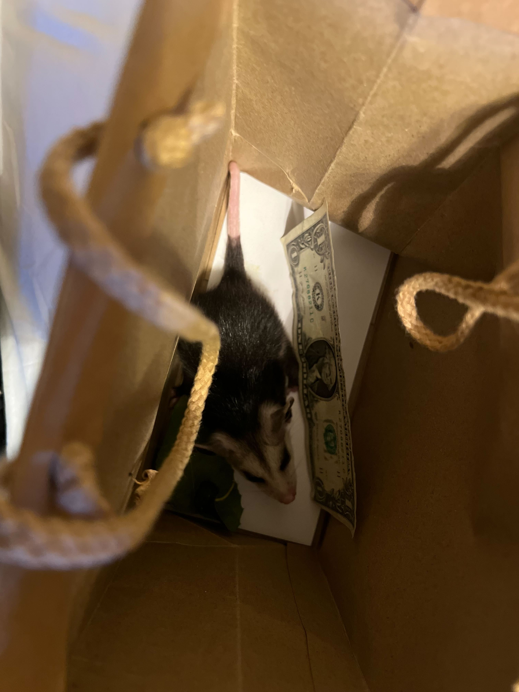
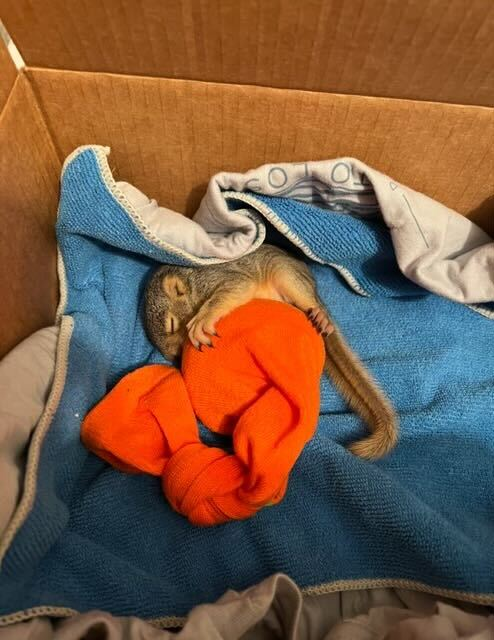
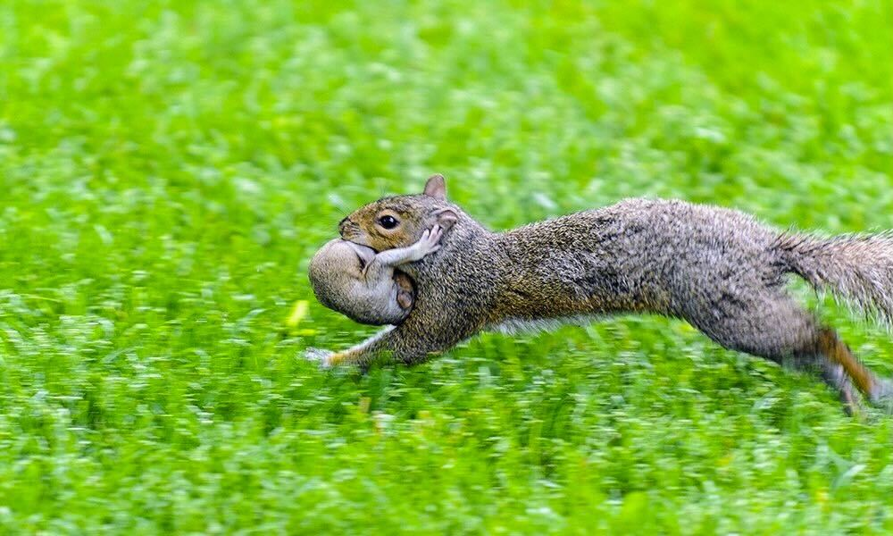

These are template responses to common Requesting Party's (RP) text messages. Customize them as needed.

# Contents
### General
* [First Response - Send WRMD Form](#first-response---send-wrmd-form)
* [After Hours - Send WRMD Form](#after-hours---send-wrmd-form)
* [Donate](#donate)
* [ETA?](#eta)
* [Humane Exclusion Service](#humane-exclusion-service)
* [Humane Pest Control - Rats](#humane-pest-control---rats)
* [Illegal for Public to Rehab](#illegal-for-public-to-rehab)
* [Illegal to Relocate](#illegal-to-relocate)
* [Meet in Goodwill Parking](#meet-in-goodwill-parking)
* [Not in Our Service Area](#not-in-our-service-area)
* [Update on Animal](#update-on-animal)
* [Will You Treat the Animal or Just Kill It?](#will-you-treat-the-animal-or-just-kill-it)


### Animals
* [Avian Influenza](#avian-influenza)
* [Bears](#bears)
* [Bees](#bees)
* [Birds](#birds)
   * [Nestlings](#nestlings)
   * [Nestling Re-nesting](#nestling-re-nesting)
   * [Fledglings](#fledglings)
   * [Window Strike Bird (with no obvious injuries)](#window-strike-bird-with-no-obvious-injuries)
* [Bobcats](#bobcats)
* [Coyotes](#coyotes)
* [Dead Animals](#dead-animals)
* [Deer](#deer)
* [Ducks](#ducks)
   * [Ducks in Yards and Pools](#ducks-in-yards-and-pools)
   * [Legal Protections](#legal-protections)
* [Opossum](#opossum)
   * [Dollar bill size and larger (if uninjured)](#dollar-bill-size-and-larger-if-uninjured)
* [Peafowl Deterrents](#peafowl-deterrents)
* [Predation Event](#predation-event)
* [Rabbit RHDV](#rabbit-rhdv)
* [Raccoon](#raccoon)
* [Rats and Mice](#rats-and-mice)
* [Skunk](#skunk)
   * [Uninjured Baby](#uninjured-baby-1)
* [Snakes](#snakes)
* [Squirrel](#squirrel)
   * [If found in the AM](#if-found-in-the-am)
   * [If found in the PM and it looks healthy](#if-found-in-the-pm-and-it-looks-healthy)
   * [Shoe box/container examples:](#shoe-boxcontainer-examples)
   * [Makeshift heating pad example:](#makeshift-heating-pad-example)
   * [Reunited examples:](#reunited-examples)

# First Response - Send WRMD Form
```
Hello, thank you for reaching out to the Pasadena Humane Wildlife Helpline.

Please complete and submit our animal report form at the following link and send us the confirmation code when it is done.

https://wrmd.org/embed/public-animal-report-form/GVJ8x8qoqWPeuIWdqqCMSqwTLPE8am848jsF8LUhrJLcIlDE/

Thank you for your help. We will be in touch as soon as possible.
```
# After Hours - Send WRMD Form
```
Hello, thank you for reaching out to Pasadena Humane Wildlife Helpline. You have messaged us outside of our operating hours, which are from 9:30 AM to 5:30 PM daily. Please help us determine what is best for the animal by submitting a completed animal report form at the following link and sending us the confirmation code when it is done. For urgent help after hours you may contact (626) 792-7151 x970.

https://wrmd.org/embed/public-animal-report-form/GVJ8x8qoqWPeuIWdqqCMSqwTLPE8am848jsF8LUhrJLcIlDE/

Thank you for your help. We will be in touch as soon as possible.
```
# Avian Influenza
⚠️⚠️ **NOTICE:** Due to the increase of Highly Pathogenic Avian Influenza (HPAI) cases, we are admitting waterfowl for euthanasia only. [Read more about HPAI.](https://calepa.ca.gov/disaster/ainfluenza/)
1. **Not Gravely Injured Waterfowls**
    ```
    Hello, thank you for reaching out to Pasadena Humane Wildlife Helpline. Our policy is to only intervene when absolutely necessary, especially with highly stress-prone species. There is also a highly pathogenic avian influenza throughout California, so we are even MORE careful about which birds we are admitting. It has been detected in mainly waterfowl and some scavenging species (like raptors and corvids). Since the condition of this animal is not severe enough to necessitate humane euthanasia, we recommend the animal be left alone. We would like to give it the opportunity to recover on its own. If its condition deteriorates further, please contact us again. You may also contact IBR (International Bird Rescue) at `(310) 514-2573` to see if they have the capacity to intake it.
    ```
2. **Healthy Orphaned Waterfowl (not including Mallards)**
    1. Try to REUNITE
    2. Intake if reunion was unsuccessful
# Bears
```
Hello, thank you for reaching out to Pasadena Humane Wildlife Helpline. This flyer includes information about bears: https://pasadenahumane.org/wp-content/uploads/2023/04/23_4_Wildlife-Flyers_Web_Bear.pdf

Bears are native wildlife and are a valuable part of our ecosystem. They are under the jurisdiction of the California Department of Fish and Wildlife and we are not authorized to trap or relocate them.

Bears go where there are resources and their behavior changes based on how humans react to them, so it is important that we avoid them by not providing them with food, water, or shelter.

The only sustainable and effective way to stop unwanted bear activity is to consistently haze them when they are on your property or near humans. Take every opportunity to make them feel uncomfortable by hazing them with loud noises (i.e., air horns, banging pots and pans), squirting them with a hose, quickly opening and closing an umbrella, etc.

In Southern California, black bears do not naturally see humans (even children) as prey - their natural instinct is to fear humans. Children should be taught how to haze. Passive hazing devices like motion-sensing sprinklers and bear fencing help deter bears and other wildlife when you are not home, but the most effective thing is to make sure there are no food, water, or shelter resources that would attract the bear to the property in the first place. 

Small children and pets must be supervised at all times while outside, dogs kept close by and on 6 feet or shorter leashes, and cats be kept indoors or provided an enclosed, predator-proof catio for safety.

You may email wildlife@pasadenahumane.org with any further questions. Thank you for your consideration and support.
```
# Bees
```
Hello, thank you for reaching out to Pasadena Humane Wildlife Helpline. We do not handle Bees, so we would refer you to service providers that may take care of your Bee situation. Please note that they will likely charge a fee for this service.

Dave Williams
- Tel: 626-791-8979
- Cell: 626-808-1771
- Email: baileystream@gmail.com

Noah's Farm (Hossein Saeedy)
- Tel: 626-893-4355
- Email: zerangsaveh@yahoo.com

Anthony & Valeriy Barkanov
- Tel: 626-775-4207
- Cell: 714-469-8721
- Email: vbarkanov@msn.com

LeRoy Steese
- Tel: 818-282-3208
- Tel: 818-282-3209 
- Email: Beekeepersteese@gmail.com

Save My Bees (Byron Levy)
- Tel: 707-888-4644
- Email: hello@savemybees.com
- Web: https://www.savemybees.com

Lea and Leon Johnson
- Tel: 310-924-2168
- Email: leajohnson@yahoo.com
```
# Birds
### Nestlings
```
It appears that this is a healthy nestling. The best thing you may do for this bird is to reunite the baby back with its parents. The parents are able to provide round the clock care for the baby and they do a better job of taking care of it than any human could. Please follow the steps in this flowchart linked here:

https://pasadenahumane.org/wp-content/uploads/2021/02/Baby-Bird-Flow-Chart_2021.pdf
```
### Nestling Re-nesting
```
It appears that this a nestling and its legs might not be strong enough to stand or walk on its own. The best thing you may do for this bird is to re-nest it and see if its parents are still around. 

Please get a small container such as a box and line it with tissue paper and some twigs or leaves. Make sure to poke some holes on the bottom of the box for drainage. Place the makeshift nest with the baby bird on a nearby tree or tall bush - somewhere sturdy. You may tape the makeshift nest or use zip ties to secure it to the tree. If successful, the parents will move into that nest and continue to take care of the baby. Please watch from a distance (20+ ft) to see if any birds come back to the makeshift nest, but do not get too close as to scare the parents off and prevent them from returning. Most parents will only come back for a quick second to feed their babies then leave, so do not be alarmed if you do not see them. 

Please do not feed the baby and do not check up on it more than once every 2 hours or so as this will scare the parents away. Please let us know if the baby’s condition or attitude changes or if you have any other questions.
```
* More details in the [Nestling Reunite Script](Nestling-Reunite-Script).
* More details in [Making a Nest](Making-a-Nest).
### Fledglings
```
It appears that this is a fledgling. At this age they start hopping out of their nest and learning how to fly. These fledglings may stay on the ground for up to 2 weeks before they gain the muscles and learn to fly away. The parents are still around to feed and take care of it, so you should release it under some natural covering nearest to where you found it. It only takes a few seconds for the parents to come back and feed it each time, so it's easy to miss. Please do not feed the bird or check up on it more than once every 2 hours, as this will scare the parents away. Please let us know if you see that the fledgling's condition deteriorates, closing its eyes for long periods, or if it may no longer sit up. Thank you for your efforts.
```
### Window Strike Bird (with no obvious injuries)
- We may admit these for supportive care.

# Bobcats
```
Hello, thank you for reaching out to Pasadena Humane Wildlife Helpline. This flyer includes information and helpful tips: 

https://pasadenahumane.org/wp-content/uploads/2023/04/23_4_Wildlife-Flyers_Web_Bobcat.pdf

Bobcats are native wildlife and are free to roam as determined under the jurisdiction of the Department of Fish and Wildlife; Pasadena Humane is not authorized to trap or relocate them. They are also a valuable part of our ecosystem, keeping rodent populations down and providing free carrion removal, among other benefits. Bobcats are opportunistic carnivores and will eat whatever they may catch. Although they prefer rabbits and rodents, bobcats will also eat small reptiles, birds, feral cats, eggs, and occasionally deer and small livestock. Bobcats do most of their hunting at dawn, dusk, and through the night, but will come out whenever it is most convenient for them to find resources.

Bobcats go where there are resources, and their behavior changes based on how humans react to them - so it is imperative we avoid intentionally or unintentionally providing food, water, or shelter to bobcats.

Hazing bobcats whenever they are on our properties or near people is the only sustainable and effective way to alter unwanted behavior. We should take every opportunity to make bobcats uncomfortable around humans by hazing them with things like loud noises (i.e. air horns, banging pots and pans), squirting them with a hose, quickly opening and closing an umbrella, etc.

In Southern California, bobcats only grow on average to around 20 pounds and do not naturally see humans (even children) as prey - their natural instinct is to fear humans and tend to be solitary and shy. Children should be taught how to haze. Passive hazing devices like motion-sensing sprinklers and coyote rollers for fences help deter bobcats and other wildlife when you are not home.

We recommend children and pets be supervised at all times while outside, dogs be kept close by and on 6 ft or shorter leashes, and cats be kept indoors or provided an enclosed catio for safety.

You may email wildlife@pasadenahumane.org with any further questions. Thank you for your consideration and support.
```
# Coyotes
```
Hello, thank you for reaching out to Pasadena Humane Wildlife Helpline. This flyer includes information and helpful tips:

https://pasadenahumane.org/wp-content/uploads/2023/04/23_4_Wildlife-Flyers_Web_Coyote.pdf

Coyotes are native wildlife and are under the jurisdiction of the California Department of Fish and Wildlife. Pasadena Humane is not authorized to trap or relocate them. They are also a valuable part of our environment, keeping rodent populations down and providing free carrion removal, among other benefits. Removing coyotes from our local ecosystem is not feasible nor would it be ecological beneficial.

Coyotes go where there are resources, and their behavior changes based on how humans react to them, so we must not provide food, water, or shelter to them, even unintentionally. You are responsible for your safety and the safety of your pets and family. This includes educating yourself on what is normal behavior and what to do when you encounter coyotes, and we are here to help.

Consistently hazing coyotes whenever they are on your property or near people continuously until they have left the area is the only sustainable and effective way to alter unwanted behavior. We should take every opportunity to make coyotes uncomfortable by hazing them with things like loud noises (i.e. air horns, banging pots and pans), squirting them with a hose, quickly opening and closing an umbrella, etc. NEVER turn your back or run from coyotes. 

In Southern California, coyotes only grow up to about 35 pounds and do not naturally see humans (even children) as prey. It is their instinct is to fear humans. Children should be taught how to haze coyotes under adult supervision. Dogs should always be kept close by and on 6ft or shorter leashes when outside. Cats should be kept indoors at all times or given a Catio for their safety and comfort. Passive hazing devices like motion-sensing sprinklers and coyote rollers atop 6 foot fences help deter coyotes and other wildlife when you are not home.

Our website here has more information:
https://pasadenahumane.org/services/wildlife/

If you observe that the Coyote's condition deteriorates such that it is unable to get away, loses function of 2 or more limbs, and is unresponsive to hazing, then please contact us again at this number or our dispatch line. The hours for this wildlife helpline are from 9:30 AM to 5:30 PM. Our after-hours dispatch line is (626) 792-7151 x970.

You may participate in community science by reporting all coyote sightings and encounters at https://ucanr.edu/sites/CoyoteCacher/
You may also email wildlife@pasadenahumane.org with any further questions. Thank you for your consideration and support.
```
# Dead Animals
```
Hello, thank you for reaching out to Pasadena Humane Wildlife Helpline. You may dispose of the body yourself by using your trash disposal service in a garbage bag, by burying it, or by placing it in compost.

If you would like to have us pick it up, please call 626-792-7151 x265 to be connected to our DOA Pickup Request line, where you may leave a voicemail with details of the animal and its location. Thank you for your efforts.
```
# Deer
```
Hello, thank you for reaching out to Pasadena Humane Wildlife Helpline. Here is a flyer with more information about Deer:
https://pasadenahumane.org/wp-content/uploads/2023/04/23_4_Wildlife-Flyers_Web_Deer.pdf

Deer are native wildlife and are under the jurisdiction of the California Department of Fish and Wildlife. We are not authorized to trap or relocate healthy deer. If you observe that the Deer's condition deteriorates such that it is unable to get away, loses function of 2 or more limbs, and is unresponsive to hazing, then please contact us again at this number or our dispatch line. The hours for this wildlife helpline are from 9:30 AM to 5:30 PM. Our after-hours dispatch line is (626) 792-7151 x970.

You may email wildlife@pasadenahumane.org with any further questions. Thank you for your consideration and support.
```
# Donate
```
Thank you for assisting wildlife in distress. Your ongoing support is vital to the wildlife in our community. As a non-profit organization, we rely on donations to care for the thousands of wild animals who need our care each year. Please consider giving today to help ensure we may continue this critical program:

https://pasadenahumane.org/supportwildlife
```
# Ducks

### Ducks in Yards and Pools
```
Hello, thank you for reaching out to Pasadena Humane Wildlife Helpline. Your yard or pool might be an inviting place for ducks to rest or build a nest. Water features, vegetation, and quiet spaces may make it an ideal spot for them to raise a brood. Below are tips for how to respond when ducks have made your yard or pool their temporary home.

If You Have Nesting Ducks in Your Yard:
- Enjoy watching the wildlife and observe their behavior from a distance.
- Keep pets and children away from the nest.
- Avoid disturbing the ducks during the nesting period.

If There Are Ducks in Your Pool:
- Ducklings cannot fly or step out of pools with tall ledges and may drown if they cannot get out.
- Place a non-slippery ramp, towel, or soft board in the pool to help ducklings climb out safely.

If You Want to Discourage Nesting or Swimming in Pools:
- DO NOT destroy any nest that contains eggs. This is illegal without a federal permit.
- DO NOT leave food out or feed ducks as this encourages them to stay.
- Watch for signs of nest-searching (pairs of ducks or a female quacking and exploring during early evenings): if seen, gently scare them off before they start nesting.
- Let your dog patrol the yard before a nest is built (never allow dogs to chase ducklings or disturb an active nest).
- If you find an inactive (empty) nest, you may remove it, but be prepared to do so multiple times as ducks may try again.
- Cover your pool when not in use.
- Place brightly colored inflatable pool toys in the water-ducks tend to avoid pools with unfamiliar objects.
- Trim overgrown grass and low shrubs where ducks might nest.

If You Discover a Duck Nest:
- If you are okay with the ducks nesting, observe from a distance and allow nature to take its course.
- If you do not want ducks nesting, remove the nest before it contains eggs.
- Once eggs are laid, the nest becomes protected by federal law and may not be disturbed.

If Ducks Are Trapped in an Enclosed Yard:
- Open a gate or path so the ducks may leave on their own.
- Gently guide them toward the exit, but do not scare the mother away from her ducklings.
- If you cannot safely guide the ducks out, contact a licensed wildlife rehabilitator for help.

Nests with Eggs or Ducklings Are Protected:
- Once eggs are laid, the nest becomes protected by federal law and may not be disturbed.
- Ducklings usually hatch after about 25 days. Within 24 hours of hatching, the mother will lead them to water.
- During this time, keep pets and children away from the duck family.
```
### Legal Protections
```
Ducks/Mallards are protected under the Migratory Bird Treaty Act of 1918.

It is illegal to:
- Take, possess, relocate, sell, or purchase Mallards or any of their parts (feathers, eggs, nests, etc.) without a permit.
- Disturb or destroy active nests (those with eggs or chicks) without a permit from the U.S. Fish and Wildlife Service.
- The U.S. Fish and Wildlife Service does not issue permits to remove Mallards, their eggs, or active nests from pools or enclosed yards.

If You See Injured or Distressed Ducks:
- If a duck appears injured (limping, unable to fly, bleeding, or stuck), or if ducklings are orphaned or abandoned, please let us know.
- Do not attempt to capture or care for injured ducks yourself unless instructed to do so - it’s easy to accidentally cause more harm.
```
# ETA?
```
Unfortunately, we are unable to give an ETA since it depends on various factors, but an animal control officer has been dispatched. It typically takes roughly 30 minutes to 3 hours for them to arrive.

If you need to leave, you may safely place the animal in a box on your porch (or another accessible spot) for pickup. If you cannot confine it, please let us know what time you will be back so an officer may meet you then.
```
# Humane Exclusion Service
```
Hello, thank you for reaching out to Pasadena Humane Wildlife Helpline. We offer a humane wildlife exclusion service where we help with wildlife conflict issues as an alternative to conventional pest control companies which often trap and euthanize wildlife.

It is important for you to know that we do not trap and relocate wildlife, but we may assist with deterring and humanely evicting wildlife from your property. We provide a detailed consultation after an initial inspection of the property, allowing us to give precise and accurate advice that is specific to your needs. All situations are different, and we want to find the best solution for you. The initial inspection cost for a site visit in our service area is $145. You may find a detailed breakdown of services on our website:
https://pasadenahumane.org/services/wildlife/humane-wildlife-exclusion/

If you are looking for advice on how to handle an exclusion yourself, please refer to the following website where you may find great information on DIY solutions. We do not, unfortunately, have the extra time and resources to spend on the phone giving DIY advice.
https://awces.com/self-help 

You may email wildlife@pasadenahumane.org with any further questions. To request an initial site inspection, please fill out this form:
https://forms.cloud.microsoft/r/Hf1hfpyEW7
```
# Humane Pest Control - Rats
```
For the cost of an initial site inspection of $145, The Pasadena Humane Wildlife Team may provide customized consultation to help you prevent rats/rodents from entering your property. To request an initial site inspection, please fill out this form:
https://forms.cloud.microsoft/r/Hf1hfpyEW7

Since we do not have the capacity to do the actual structure seal and exclusion installation, we instead recommend you to get services from Humane Pest Control Inc. and you may contact them here:
https://humanepestpro.com
844-PEST-PRO (844-737-8776)

You may email wildlife@pasadenahumane.org with any further questions. Thank you for addressing your conflicts with compassion!
```
# Illegal for Public to Rehab
```
Hello, thank you for reaching out to Pasadena Humane Wildlife Helpline. California Code of Regulations, Title 14, Section 679 gives the public 48 hours to contact the California Department of Fish and Wildlife or a licensed rehabilitator to place an injured or orphaned wild animal. Keeping wild animals beyond that window is not legal, nor is it in the best interest of the animal. Licensed wildlife rehabilitators hold specific permits from Fish and Wildlife that allow them to care for wildlife in captivity. Those permits exist because captivity is extremely stressful for wild animals, and they need species-specific care. Even with the best intentions, well-meaning rescuers may unintentionally cause a wild animal to die from something called capture myopathy, a stress response to human handling.

Please contact a licensed wildlife rehabilitator using the following website as soon as possible, as they will not allow an animal to continue suffering. Thank you for your consideration and support.
https://wildlife.ca.gov/Conservation/Laboratories/Wildlife-Health/Rehab/Facilities
```
# Illegal to Relocate
```
Hello, thank you for reaching out to Pasadena Humane Wildlife Helpline. It is illegal to relocate wildlife in the state of California per Section 465.5 of 14 of the California Code of Regulations. The most appropriate thing to do is to release the animal on the same property where it was trapped. Please let us know if you need more advice about this. Thank you for your consideration and support.
```
# Meet in Goodwill Parking
```
Since you will be in close quarters with a wild animal, please minimize further stress for it by not playing loud music, keeping voices to a whisper, keeping the animal in a covered container, and refrain from peeking in at it. If possible, please place the animal in a secure location such as the passenger side floor in the vehicle to prevent constant/sudden movements during the car ride. Do not smoke or bring along pets while transporting the animal. 

Please head to the Goodwill parking lot just behind Pasadena Humane: 340 S Fair Oaks, Pasadena, CA 91105

We have two reserved parking spots in the southeast section of the Goodwill parking lot for our Wildlife Department. When you have arrived, please stay inside your car and let us know with a text. We will be out to meet you as soon as we are available. Thank you for your willingness to help our wild neighbors!
```


# Not in Our Service Area
```
Hello, thank you for reaching out to Pasadena Humane Wildlife Helpline. Unfortunately, you are outside of our service area. We may only accept animals from inside our service cities at this time. You may read more about it here:
https://pasadenahumane.org/services/animal-care-and-control/animal-control

We suggest finding another licensed rehabilitation center through this website:
https://wildlife.ca.gov/Conservation/Laboratories/Wildlife-Health/Rehab/Facilities

Below is also a list of animal shelters in Los Angeles County where you may find the appropriate contact for animal control services: 
https://acwm.lacounty.gov/animal-control-shelter-services/

You may also try contacting your local exotic veterinary clinic. Thank you for your consideration and support.
```
# Opossum 

### Dollar bill size and larger (if uninjured)
```
Great news! This opossum is old enough to be on its own. This is the age that they will start to fall off of mom's back and venture off on their own. You may place the opossum back outside under a bush or other coverage so they may continue exploring their surroundings and grow.

Thank you for your consideration and support.
```


# Peafowl Deterrents
```
Hello, thank you for reaching out to Pasadena Humane Wildlife Helpline. This flyer includes information and helpful tips: 
https://pasadenahumane.org/wp-content/uploads/2023/04/23_4_Wildlife-Flyers_Web_Peafowl.pdf

Peafowls do not like water: Water is one of the best-known deterrents for peafowl. The intermittent use of sprinklers or a hose with a jet nozzle will act as a negative reinforcement for the birds. Also, consider a motion sensor activated water spray, such as the Scarecrow, which is battery operated and covers an area of about 35 feet and may be connected to your garden hose. It's available online or at garden stores.

Avoid planting young tender seedlings in areas you do not want peafowl to visit or cover the plants until they are well established. There are also a variety of plants peafowl do not eat/like and may help with deterrence. You may read more about it here: 
https://www.rpvca.gov/510/Dealing-with-Peafowl

Peafowls will avoid certain repellents: Cat repellent around planting beds, porches, and along walkways may be an effective means of repelling peafowl. Be cautious to not to allow young children or animals to ingest the repellents.

Peafowls are afraid of dogs: Walk your dog around the property and neighborhood to deter them.

Peafowls like to eat seeds, bugs, and worms: Avoid open compost and manure sacks. If you wish to compost, use a covered compost bin and keep the composting area clean. Peafowl like to eat wild birdseed, bread, and pet food. These are delectable treats to peafowl. Once they are attracted, it is difficult to wean them off of it. It is a good idea to remove any leftover pet food immediately or only feed pets indoors.

Peafowls prefer to roost in safe areas, such as overhanging trees: Hire a certified Arborist to trim or thin overhanging trees in the fall and winter to avoid roosting.

You may email wildlife@pasadenahumane.org with any further questions. Thank you for your consideration and support.
```
# Predation Event
```
Hello, thank you for reaching out to Pasadena Humane Wildlife Helpline. We understand it may be upsetting to witness a predation event, but these interactions are a natural part of a healthy ecosystem. For this reason, we do not intervene in native wildlife predation and allow these situations to unfold without human interference. If the predator has left the area with no sign of return after 30 minutes, please reach out again and we may reassess the situation.

Thank you for your consideration and support.
```
# Raccoon
### Uninjured Baby
```
Hello, thank you for reaching out to Pasadena Humane Wildlife Helpline. Place the baby in a shaded area near where it was found and place an empty laundry basket over the baby raccoon. This prevents other animals from taking it and keeps the baby out of danger. Play some baby raccoon calls on a speaker and wait a few hours. Raccoons are nocturnal, so they are more active at night. Leave the baby out overnight to see if the mom will come back for it. The mom is able to lift the basket over to retrieve the baby. Please reach out again if the baby's attitude changes, or if it is still there by the following morning. 

Thank you for your consideration and support.
```
# Rabbit RHDV
```
Hello, thank you for reaching out to Pasadena Humane Wildlife Helpline. Due to Rabbit Hemorrhagic Disease Virus (RHDV), we are unable to rehab wild rabbits at our center. Since our campus also houses domestic rabbits available for adoption in the shelter, the risk of spreading this highly contagious and often fatal virus is too great. You may read more about it here: 
https://www.cdfa.ca.gov/AHFSS/Animal_Health/RHD.html

Thank you for your consideration and support.
```
# Rats and Mice
```
Hello, thank you for reaching out to Pasadena Humane Wildlife Helpline. We do not rehabilitate mice or rats, and neither do our partner wildlife rehab centers. If you are within our service area, we may accept the animal for humane euthanasia. If you are outside our service area, please surrender the animal to your local animal control or a local veterinarian. You may see if you are in our service area here:
https://pasadenahumane.org/services/animal-care-and-control/animal-control

Thank you for your consideration and support.
```
# Skunk

### Uninjured Baby
```
Hello, thank you for reaching out to Pasadena Humane Wildlife Helpline. Please place the baby in a shaded area near where it was found and place a light laundry basket over it. This prevents other animals from taking it and keeps the baby out of danger. Skunks are nocturnal, so they are more active at night, but may try to find their babies in the day time. Leave the baby out overnight to see if the mom will come back for it, mom will lift the laundry basket to retrieve the baby. Do not feed the baby or take it inside. Do not handle the skunk unless absolutely necessary using thick gloves or a towel. Skunks are considered rabies vector species and any bites or scratches must be reported and treated by a medical professional as soon as possible.

Please reach out to us again if the baby's attitude changes or if it is still there by the following morning. Thank you for your consideration and support.
```
# Snakes

For helpline personnel: Review the following links to help identify the species of snake for the RP. Gopher snakes are often mistaken for rattlesnakes although they are almost harmless and very beneficial pest control. Dangerous venomous snakes have a large, wide head with cat-eye pupils in their eyes, and large scales on their body.

- https://californiaherps.com/identification/snakesid/common.html
- https://californiaherps.com/snakes/snakespics.html
- https://www.losangelessnakes.com

# Squirrel

### If found in the AM
```
Hello, thank you for reaching out to Pasadena Humane Wildlife Helpline. Please place the baby in a shoebox or similar container and place the box back as close to where the baby was found as reasonable. You may place a makeshift heating pad (warm rice-filled sock) in the box if you would like, ensure it is not too hot by holding to your skin for 5-10 seconds. Using a wireless or phone speaker, play baby fox squirrel calls which may be found on YouTube. Place the speaker near the baby for a few hours and do not disturb it. The parent should return for the baby and carry it back to the nest. Please let us know if the baby's condition declines or if the baby is still there by 4:00 PM.

Thank you for your consideration and support.
```
### If found in the PM and it looks healthy
```
Hello, thank you for reaching out to Pasadena Humane Wildlife Helpline. We would like to give the parents the chance to come back for their baby. Since there are a few hours of daylight left, please place the baby in a shoebox or similar container and place the box back as close to where the baby was found as reasonable. You may place a makeshift heating pad (warm rice-filled sock) in the box if you would like to, ensure it it not too hot by holding to your skin for 5-10 seconds. Using a wireless or phone speaker, play baby fox squirrel calls which may be found on YouTube. Place the speaker near the baby for a few hours and do not disturb it. Please do not attempt to feed or water the squirrel.

The parent should return for the baby and carry it back to the nest. If the baby is still there when it is dark outside, you may bring the baby inside and place it in an enclosed box in a warm, quiet area away from pets and people. Refrain from interacting or handling it unless absolutely necessary. Place the baby outside again tomorrow morning shortly after sunrise to try again. 

Please contact us after 9:30 AM if the baby is still there. If its condition declines after hours, please call dispatch at 626-792-7151 x970. Thank you for your consideration and support.
```
### Shoe box/container examples:


### Makeshift heating pad example:



### Reunited examples:



[Squirrel reunited video # 1](assets/videos/squirrel-reunite-1.MOV) (click to download)

[Squirrel reunited video # 2](assets/videos/squirrel-reunite-2.MOV) (click to download)

# Update on Animal
```
Thank you for your care and compassion for our wildlife neighbors. For updates, please email wildlife@pasadenahumane.org and include your name, phone number, address the animal was found, and following animal ID number.

Your ID # is 

Please allow at least 7 days for a response as our staff primarily attends to the direct care of incoming patients. Thank you.
```
# Will You Treat the Animal or Just Kill It?
```
Hello, thank you for reaching out to Pasadena Humane Wildlife Helpline. Our team consists of trained and certified wildlife veterinarians who will give all admitted wildlife animals a full medical exam and treatment in our facility inspected and licensed by state and federal agencies. Wildlife in need of long-term care will be sent to state-certified wildlife rehabilitators. Humane and compassionate euthanasia is only given when medically appropriate and to cease animal distress.

You may email wildlife@pasadenahumane.org with any further questions. Thank you for your consideration and support.
```